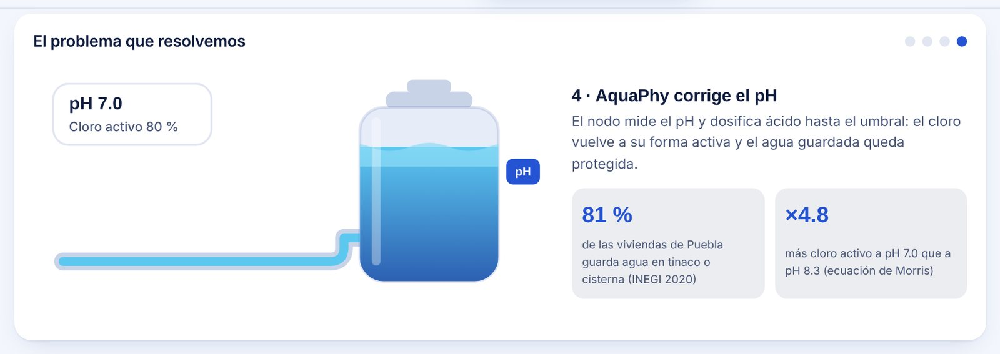
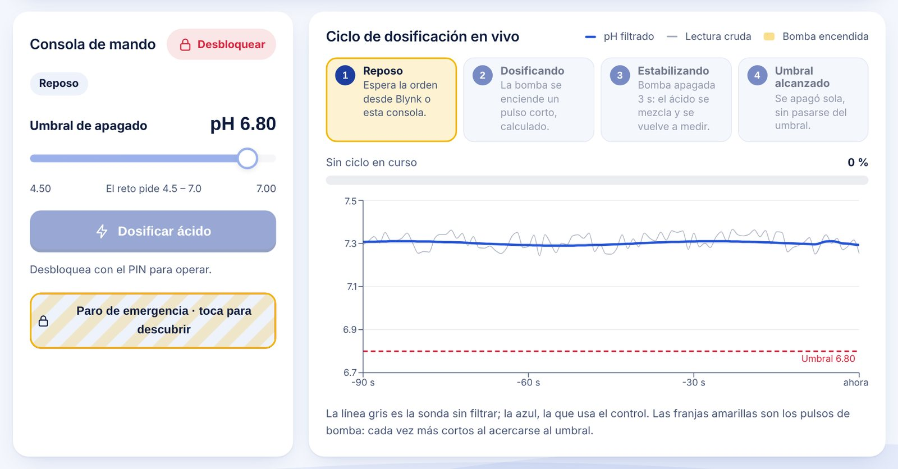
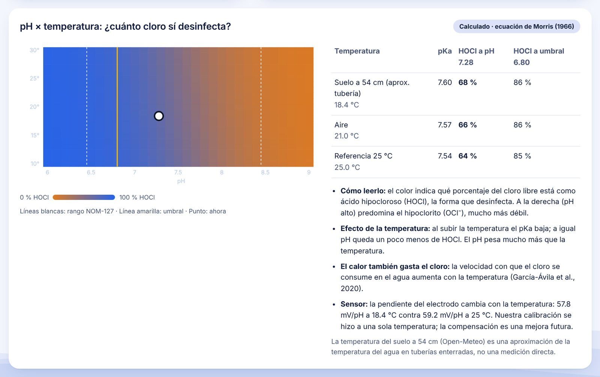
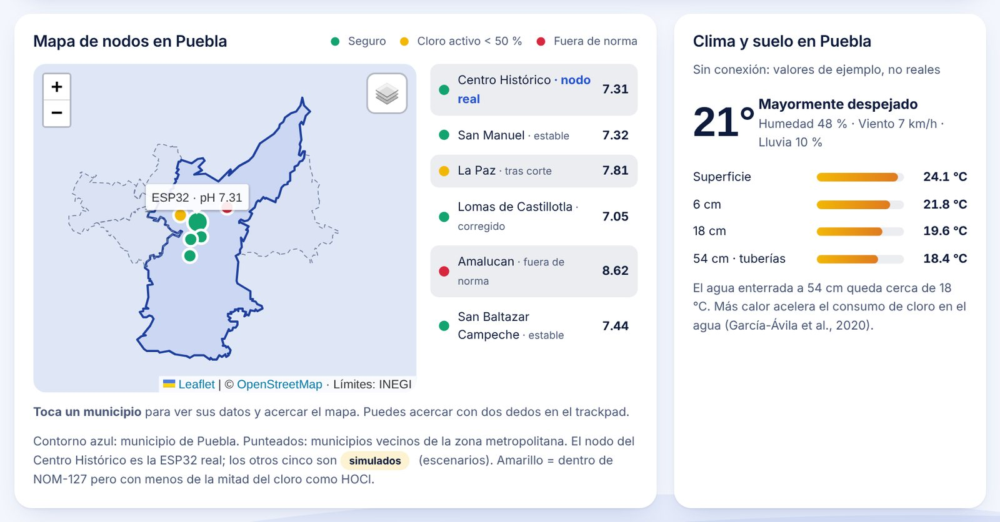
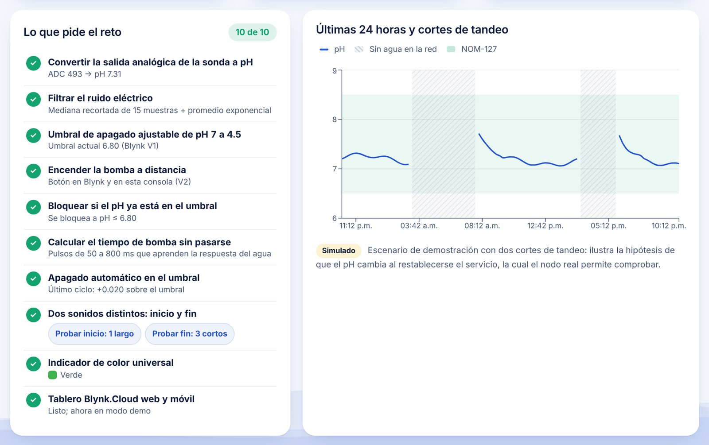
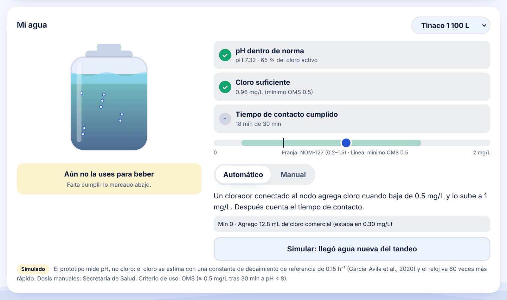
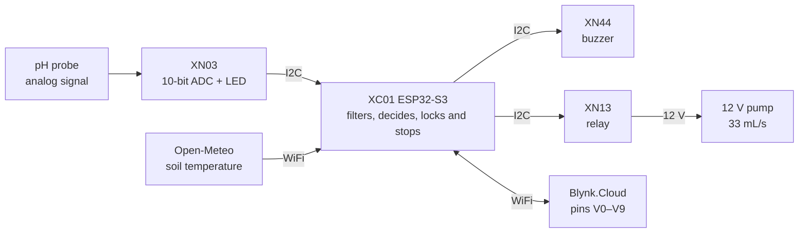
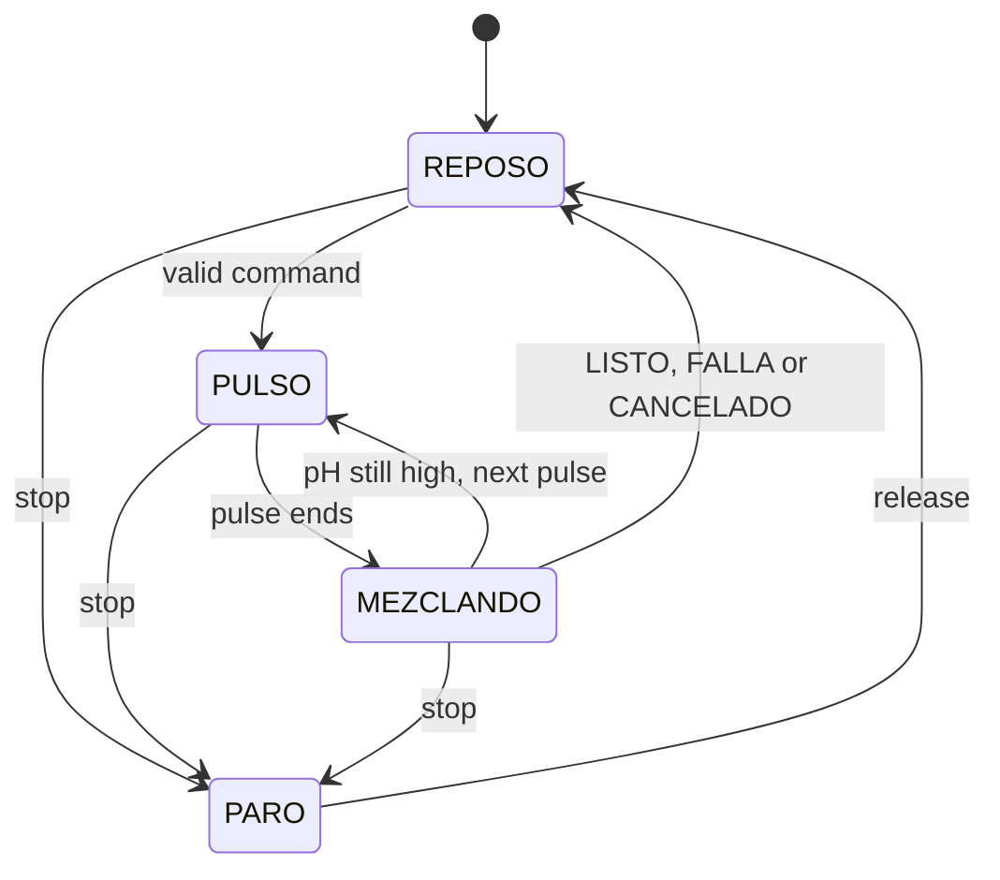

<p align="center"><a href="README.md">Español</a> | <b>English</b></p>

<p align="center">
  
</p>

# AquaPhy · pH and chlorine in Puebla's rationed water

AquaPhy is an IoT node and a web dashboard for water stored in rooftop tanks and cisterns. The node
measures the pH, doses acid down to a threshold, and the dashboard shows how much of the chlorine is still
disinfecting. Built by team **Lagoonas** for the IoT water quality monitoring and control challenge at the MICROSIDE Hackathon.

**Live:** https://aqua-phy.vercel.app

<p align="center">
  <a href="https://aqua-phy.vercel.app"></a>
</p>

## Project status

| Part | Status |
| --- | --- |
| Final firmware (`firmware/AquaPhy_ESP32`) | Working. Real calibrated reading: 5.42 vs. 5.4 on a reference meter |
| Automatic dosing | Tested in simulation; a full run with the real pump still needs to be recorded |
| Blynk panel | Working; shows the node's data in real time |
| Web dashboard | Works in demo mode; **not integrated** with the final firmware (it uses a different pin map) |

## Contents

- [The problem](#the-problem)
- [Components](#components)
- [Dashboard views](#dashboard-views)
- [Running it](#running-it)
- [Firmware](#firmware)
- [Pins used by the dashboard](#pins-used-by-the-dashboard)
- [Project progress](#project-progress)
- [Next steps](#next-steps)
- [Data and assumptions](#data-and-assumptions)
- [References](#references)
- [Structure](#structure)
- [Team Lagoonas](#team-lagoonas)

## The problem

In Puebla, water arrives by **rationing (tandeo)**: the mains go dry for hours or days, so 81.3 % of homes
store water in a rooftop tank or cistern (INEGI, 2020 Census). Stored chlorine decays over time, faster
in warm weather. And when pH rises, most of the chlorine shifts to its weak form (hypochlorite) and barely
disinfects.

AquaPhy measures pH and lowers it to the chosen threshold with short acid pulses. It then uses the Morris
equation to calculate how much of the chlorine is in its active form (hypochlorous acid, HOCl). At pH 7.0
there is roughly five times more active chlorine than at pH 8.3.

<p align="center">
  
</p>

## Components

| Part | Technology | What it does |
| --- | --- | --- |
| Node | ESP32-S3 (XC01), pH probe, XN13 relay with pump, XN03 LED, XN44 buzzer | Reads and filters pH, doses acid in pulses, locks out on faults or emergency stop, and publishes everything to Blynk. |
| Cloud | Blynk.Cloud | Receives the node's telemetry on 10 virtual pins (V0–V9) and lets operators control it remotely. |
| Dashboard | React 19, Vite, Recharts, Leaflet, Three.js | Two views, institutional and citizen, with live data or demo mode. |
| Open data | Open-Meteo, INEGI, NOM-127-SSA1-2021 | Weather and soil temperature in Puebla, housing data and the official limits. |

## Dashboard views

### Institutional view

For the water utility operator:

- Chlorine efficacy curve with the current pH and the threshold.
- Universal pH indicator (0 to 14), using the same color as the node's LED.
- PIN-protected control console: shutoff threshold, dosing and emergency stop.
- Live dosing cycle: raw reading, filtered reading and pump pulses.
- Probe to pH: ADC counts, voltage and conversion.
- Control accuracy: how close each cycle ended to the threshold.
- Node status: board temperature, acid dosed and solar panel battery.
- Challenge requirements checklist.
- Last 24 hours, including the supply cuts.
- pH versus temperature analysis.
- Contact time and CT value.
- Node map by municipality.
- Weather and soil temperature.
- Water stored at home (INEGI).
- Event log.
- Data sources.

<p align="center">
  
</p>

<p align="center">
  
</p>

<p align="center">
  
</p>

<p align="center">
  
</p>

### Citizen view

For people who store water at home:

- **Tali:** a 3D water drop that reacts to the water status and follows the cursor.
- **Mi agua (My water):** shows the state of the tank or cistern and whether the water is safe to drink. It checks three conditions: pH, chlorine and contact time.
- **Automatic or manual chlorination:** manual mode gives the chlorine dose for the tank size.
- **Rationing countdown:** time until water next arrives, plus a "Water just arrived at my house!" button.
- **Your tank now:** a digital twin of the tank.
- **Care for your water:** educational cards.

<p align="center">
  
</p>

<p align="center">
  
</p>

The dashboard has light and dark themes, sounds in sync with the node's buzzer, and pop-up alerts. It locks
operation based on temperature or pH:

- **Sounds:** one long tone at start, three short ones at the end, and droplets while the pump runs. (This is the previous firmware's pattern; the final firmware uses melodies, see [Indicators](#indicators-led-and-sounds).)
- **Pop-up alerts:** they warn when the board overheats or when an operation is locked.

The interface is in Spanish.

## Running it

Requirements: Node.js 20.19 or later and npm.

```bash
npm install
npm run dev          # http://localhost:5173
npm run build        # dist/ folder for Vercel or Netlify
npm run build:single # self-contained dist-single/index.html (Blynk HTML widget or sharing)
```

**Demo mode:** without a token, the dashboard starts with a simulator that mirrors the firmware's state machine.
To connect it to a real node:

1. Open the gear icon and go to "Conexión con Blynk".
2. Paste the server and the token.

The same dialog has "Simular calor" to trigger the temperature alert.

To set the token for a deployment, copy `.env.example` to `.env` and fill in `VITE_BLYNK_TOKEN`. The token
is visible in the browser, so use it for demos only. The console PIN is in `src/config.js`
(`PIN_OPERADOR`).

## Firmware

The final firmware is in `firmware/AquaPhy_ESP32/AquaPhy_ESP32.ino` (AquaMind SmartDose). All the logic runs on the ESP32-S3: reading and filtering the probe, computing pH with its error margin, pump control, alerts and the emergency stop. Blynk shows the data and sends commands, and the node decides whether it is safe to obey them.

The same program has two modes. In **REAL mode** it reads the probe and drives the pump. In **DEMO mode** the pH comes from a built-in simulator with 10 scenarios and the relay never turns on.

### Users and needs

Based on what the code does, the prototype serves two users:

- **Operator:** uses the Blynk panel to see the pH, set the threshold, start dosing and trigger the stop.
- **Technician:** uses the Serial Monitor for diagnostics and calibration, and reads the LED patterns and buzzer sounds when opening the enclosure.

Needs the code covers:

- Knowing how much solution to add without overshooting the threshold.
- Not dosing if the pH is already at the threshold or the reading is unreliable.
- Knowing the error margin of every reading.
- Getting alerts with the likely cause of a fault.
- Stopping the pump immediately from more than one place.

### Node hardware

| Component | Function | Wiring and technical data |
| --- | --- | --- |
| pH electrode + PH_Sensor board | Measures acidity and outputs an analog voltage | V+ to 3V3, G to GND, Po to XN03 IN1, To to IN2 (optional) |
| XN03 | Converts the voltage to digital and shows the pH color | I2C 0x03; 10-bit ADC (0–1023); register 0x21 = IN1, 0x22 = IN2; RGB LED at register 0x01 |
| XN13 | Relay that switches the 12 V pump | I2C 0x0D; 1-byte format (0x01 on, 0x00 off), confirmed by testing |
| XC01 R5-I | ESP32-S3 microcontroller with WiFi | I2C on SDA 12 and SCL 13; BOOT button (GPIO 0) as emergency stop |
| XN44 | Buzzer for audible alerts | I2C 0x2C; 2-byte frequency and 2-byte duration |
| XN14 | Power supply | 12 V input; 5 V and 3.3 V outputs |
| 12 V diaphragm pump | Adds the buffer solution | 33 mL/s; minimum pulse 50 ms (1.65 mL), maximum 1500 ms (49.5 mL) |
| Containers | pH 4 solution and test water | 100 mL of solution and 200 mL of water |

**Pump to relay:** 12 V (+) to COM, NO to the pump's (+), pump's (−) to GND, NC unconnected.



All decisions are made on the ESP32: Blynk shows the data and sends commands, and the node decides whether it is safe to obey them. The XN14 supply powers every module.

### Tools and technologies

| Type | Tool | Use |
| --- | --- | --- |
| Language | C++ (Arduino) | The whole firmware in a single file |
| Environment | Arduino IDE with "ESP32S3 Dev Module" board and "USB CDC On Boot: Enabled" | Build, upload and Serial Monitor at 115200 baud |
| External library | Blynk (Volodymyr Shymanskyy) | Connection to Blynk.Cloud |
| ESP32 libraries | Wire, WiFi, HTTPClient, Preferences, time | I2C, network, HTTP request, non-volatile memory and NTP time |
| IoT platform | Blynk.Cloud (AquaPhy template, Nodo1 device) | Web and mobile panel with 10 variables |
| External service | Open-Meteo API | Soil temperature at 54 cm and air temperature in Puebla (19.04, −98.21) |
| Hardware | Microside XIDE kit | Modules listed in [Node hardware](#node-hardware) |
| Dashboard | React 19, Vite, Recharts, Leaflet, Three.js | Institutional and citizen views ([Dashboard views](#dashboard-views)) |

### Uploading the firmware

1. Install ESP32 board support in Arduino IDE and the **Blynk** library (Volodymyr Shymanskyy).
2. Board: **ESP32S3 Dev Module**, with **USB CDC On Boot: Enabled**.
3. Open `firmware/AquaPhy_ESP32/AquaPhy_ESP32.ino` and replace:
   - `TU_AUTH_TOKEN` with the device's Auth Token from Blynk.
   - `TU_WIFI_2_4GHZ` and `TU_CONTRASENA` with your network. The ESP32 only connects to 2.4 GHz networks.
4. Upload and open the Serial Monitor at 115200 baud with "New Line". If nothing shows up, press RST.

> [!WARNING]
> Do not commit your WiFi password or your token to the repository.

The node starts in **DEMO mode** (simulated pH, relay always off). To use the probe and pump, switch to **REAL mode** with the `m` command or by setting V6 = 0 in Blynk.

### Calibration

Put the electrode and a reference meter in the same glass, wait until the reading varies by only ±0.02 for one minute, and type `k` followed by the meter's value with a decimal point (for example `k5.40`). For two points use `p4.00` and then `p7.00` (they must differ by more than 1 pH). `f` restores the factory calibration. Calibration is stored in non-volatile memory.

> [!NOTE]
> The `k` command does not validate the value: double-check the number before sending it. Do not calibrate in rinse water; the electrode settles slowly in water with few salts.

### How the firmware works

#### Code layout

`AquaPhy_ESP32.ino` has 18 numbered sections, each with a single responsibility.

| Sections | Contents |
| --- | --- |
| 1–2 | I2C addresses, registers, factory calibration and challenge constants |
| 3–5 | Official color scale, simulation scenarios and melodies |
| 6–7 | Alert bits and state variables |
| 8–10 | I2C module functions, non-blocking sound, color and LED patterns |
| 11–12 | DEMO-mode simulator and measurement chain |
| 13 | Open-Meteo temperature and node diagnostics |
| 14 | Dosing, emergency stop and BOOT button |
| 15 | Alert checks |
| 16 | Sending data to and receiving commands from Blynk |
| 17 | Serial Monitor commands |
| 18 | Periodic tasks, setup and loop |

#### Startup

On power-up the node turns the relay off, loads the calibration and pump counters from non-volatile memory, selects scenario 0 and connects to WiFi (up to 10 s). It then gets the time over NTP (UTC−6), connects to Blynk and schedules the periodic tasks:

| Every | Task |
| --- | --- |
| 50 ms | Pump safety: turns it off if a pulse exceeds 1.8 s |
| 100 ms | Reads the probe (or the simulator) and filters |
| 1 s | pH slope, error margin, alerts and mixing check |
| 2 s | Re-asserts the relay off when it should be off; sends pH, color and state to Blynk |
| 5 s | Diagnostics: chip temperature, WiFi signal, remaining solution and pump cycles |
| 10 s | Full telemetry to Blynk |
| 15 s | Checks whether to query Open-Meteo (every 30 min, idle only) |

The main loop never calls `delay`: on every pass it handles sound, the LED, the BOOT button and the Serial Monitor.

#### pH measurement

1. Reads the XN03 ADC (input IN1) every 100 ms and keeps the last 30 readings.
2. Removes spikes with the median of the last 9 readings.
3. Smooths with an exponential filter (α = 0.2).
4. Converts to pH with the challenge's calibration line: pH = (892 − ADC) / 54.43.
5. Compensates for temperature with the Nernst equation: pH = 7 + (pH − 7) × 298.15 / (T + 273.15), with T in °C.

Water temperature is estimated from the soil temperature at 54 cm reported by Open-Meteo. If there is no response, it uses 25 °C.

**Error margin.** Every second it combines four components: noise after filtering (2/3 of the standard deviation), ADC resolution, calibration (0.10 factory, 0.05 one-point, 0.03 two-point) and temperature (±3 °C from Open-Meteo, ±10 °C for the default value). The result is the square root of the sum of their squares. From it the node computes a 0–100 quality index.

#### Dosing

Dosing is a state machine with four states: REPOSO (idle), PULSO (pulse), MEZCLANDO (mixing) and PARO (stop).



**Before starting**, the node rejects the command (BLOQUEADO state, low "no-no" sound) if there is no valid reading, if a critical alert is active, or if the pH is already at or below the threshold + 0.05.

**Learning pulse algorithm:**

1. A first minimum pulse of 1.65 mL to measure how the water responds.
2. Waits for mixing: at least 6 s; ends when the pH changes less than 0.01 pH/s or after 30 s.
3. Computes the slope: how much the pH dropped per mL. It updates it conservatively after each pulse.
4. Next pulse = 40 % × (current pH − threshold) / slope, never more than twice the previous pulse or the solution left.
5. Repeats until an end condition.

| End condition | Result |
| --- | --- |
| pH − threshold ≤ 0.05 | LISTO: threshold reached (end melody) |
| One minimum pulse would leave the pH farther from the threshold than now | LISTO: as close as possible |
| 3 pulses in a row with less than 0.02 pH change and 10 mL or more | FALLA: the pump does not change the pH |
| Less than 1.65 mL of solution left (5 mL are reserved) | FALLA: not enough solution |
| Probe disconnected or frozen during dosing | FALLA: probe fault |
| Pump on for more than 1.8 s | FALLA: pump safety |
| Cancel command (V2 = 0, `x` or `q` commands, mode change) | CANCELADO |

The reason for this algorithm is that tap water contains bicarbonate, which buffers the acid: the pH drops slowly and then falls sharply. A fixed pump time would overshoot the threshold. The system can only lower the pH.

#### Emergency stop

The stop turns the relay off and puts the node in the PARO state. It is triggered by V9 = 1 in Blynk, the `e` command or a tap on the BOOT button. It is released with V9 = 0, the `r` command or by holding BOOT for 3 s. Releasing the stop also clears the `SIN_EFECTO` alert.

#### Alerts

| Code | Priority | Triggered when |
| --- | --- | --- |
| `PARO` | Critical | The emergency stop is active |
| `SONDA_DESC` | Critical | The ADC reads below 5 or above 1018 |
| `SONDA_CONG` | Critical | The reading does not change at all for 15 s |
| `SIN_EFECTO` | Critical | 3 pulses (10 mL or more) with no pH change |
| `SENAL_RUIDOSA` | Warning | Noise exceeds 0.15 pH |
| `CAMBIO_SUBITO` | Warning | The pH changes more than 0.05 pH/s while idle |
| `SOLUCION_BAJA` | Warning | Less than 20 mL of solution left |
| `CHIP_CALIENTE` | Warning | The chip exceeds 70 °C |
| `WIFI_DEBIL` | Warning | Signal below −80 dBm |
| `MANTENIMIENTO` | Warning | The pump exceeds 5000 cycles |
| `SIN_NUBE` | Informational | No connection to Blynk |
| `FUERA_NORMA` | Informational | pH outside 6.5–8.5 (NOM-127-SSA1-2021) |

Critical alerts block dosing, sound with 10 fast beeps and repeat every 20 s. Warnings sound with 3 beeps. Informational alerts are silent.

#### Indicators: LED and sounds

| Situation | XN03 LED | XN44 buzzer |
| --- | --- | --- |
| Normal | Steady color from the official scale, blended between whole values | — |
| Dosing starts | Breathes (2 s cycle) while dosing or mixing | Rising C-E-G (1047, 1319, 1568 Hz) |
| Each pulse | — | 25 ms click at 2500 Hz |
| Dosing ends | Back to steady color | Falling G-E-C, last note long |
| Blocked | — | Two low 440 Hz notes |
| Warning | Turns off for 150 ms every 2 s | 3 beeps at 1319 Hz |
| Critical alert | Fast white strobe | 10 beeps at 1760 Hz in groups of 3+2, 3+2 |
| Stop | White blinking every 0.5 s | Falling staircase |
| No reading | Dim white | — |
| Connected to Blynk | — | Short chirp |

White is not on the pH scale, so it is reserved for faults.

#### DEMO mode

The simulator models the water's bicarbonate with Henderson-Hasselbalch (pKa₁ = 6.35) and a 4 s probe lag. Each pulse adds the acid matching the dosed volume. Values are illustrative.

| # | Scenario | What it simulates |
| --- | --- | --- |
| 0 | Normal | Water at pH 7.30 |
| 1 | Hard water / scale | pH 8.00 rising to 8.30; more bicarbonate |
| 2 | Acid discharge | pH falls toward 5.20 |
| 3 | Alkaline contaminant | pH rises toward 9.60 |
| 4 | Excess hypochlorite | Water at pH 8.80 |
| 5 | Probe disconnected | ADC stuck at 1023 |
| 6 | Damaged electrode / bubble | 0.25 pH noise and 1.5 spikes |
| 7 | Frozen signal | Identical ADC value every time |
| 8 | Empty tank / clogged hose | The solution does not get in |
| 9 | Leak / dilution | pH drifts back toward 7.30 |

### Blynk in the firmware

Datastreams of the **AquaPhy** template (device **Nodo1**) used by the final firmware:

| Pin | Name | Type | Use |
| --- | --- | --- | --- |
| V0 | ph | Double (0–14) | Filtered, compensated pH; the node also sets the widget color |
| V1 | umbral | Double (4.5–7) | Shutoff threshold (default 6.00) |
| V2 | dosificar | Integer (0–1) | 1 = start, 0 = cancel |
| V3 | estado | String | `CODIGO\|message` |
| V4 | bomba | Integer (0–1) | Pump on |
| V5 | incertidumbre | Double | ± of the pH |
| V6 | modo | Integer (0–1), default 1 | 1 = DEMO, 0 = REAL |
| V7 | escenario | Integer (0–9) | DEMO-mode scenario |
| V8 | telemetria | String | JSON every 10 s (next table) |
| V9 | paro | Integer (0–1) | 1 = stop, 0 = release |

To stay within the free plan's message limit, the node only sends a value when it changes. On connecting, it restores the threshold, mode and scenario saved in Blynk.

| V8 field | Meaning |
| --- | --- |
| `t`, `te` | Water temperature (°C) and whether it comes from Open-Meteo (1) or is the default (0) |
| `ta`, `tc` | Air and chip temperature (°C) |
| `vo` | Voltage on the To input (V) |
| `w` | WiFi signal (dBm) |
| `h` | Active chlorine as HOCl (%), using Morris's temperature-dependent pKa |
| `d` | pH rate of change (pH/min) |
| `q` | Reading quality index (0–100) |
| `v`, `r` | mL dosed in the run and mL of solution left |
| `c`, `s` | Accumulated pump cycles and seconds |
| `a` | Active alerts (bits) |
| `e`, `m` | Scenario and mode (1 = DEMO) |

### Serial Monitor commands

| Command | Action |
| --- | --- |
| `d` | Full diagnostics: reading, calibration, temperatures, WiFi, pump, I2C modules and alerts |
| `m` | Switches between DEMO and REAL |
| `s0`–`s9` | Selects a scenario (DEMO only) |
| `i5.5` | Sets the threshold and starts dosing |
| `q` | Pauses or resumes everything; turns the pump off |
| `x` | Cancels dosing |
| `e` / `r` | Triggers or releases the stop |
| `k5.40` | One-point calibration with the reference meter's value |
| `p4.00` and `p7.00` | Two-point calibration |
| `f` | Restores the factory calibration |
| `z` | Resets the pump and solution counters |
| `l` / `b` | Tests the 15 colors or the melodies |
| `c` | Smooth or whole-number colors |

## Pins used by the dashboard

The dashboard was built for the pin map of an earlier firmware version (defined in `src/config.js`). **It does not match the final firmware** (see [Blynk in the firmware](#blynk-in-the-firmware)); to integrate them, `src/config.js` has to be changed to pins V0–V9.

| Pin | Name | Type | Range | Use |
| --- | --- | --- | --- | --- |
| V0 | pH | Double | 0–14, 3 decimals | Filtered reading |
| V1 | Threshold | Double | 4.5–7, 2 decimals | Shutoff threshold |
| V2 | Dose | Integer | 0–2 | 1 start, 2 stop |
| V3 | State | Integer | 0–4 | Idle, Dosing, Settling, Threshold reached, Stop |
| V4 | Pump | Integer | 0–1 | Relay |
| V5 | Board temp. | Double | 0–100 °C | `temperatureRead()` |
| V6 | Color | String | | Universal indicator `#RRGGBB` |
| V7 | Stop | Integer | 0–1 | Emergency stop |
| V8 | Acid | Double | 0–200 mL | mL dosed |
| V9 | Voltage | Double | 0–15 V | Simulated (solar panel) |
| V10 | Pulse | Integer | 0–2000 ms | Last pulse |
| V11 | Raw pH | Double | 0–14, 3 decimals | Unfiltered, to show the noise |
| V12 | ADC | Integer | 0–1023 | 10-bit ADC counts |

Optional events (Templates → Events): `dosis_inicio`, `dosis_bloqueada`, `paro_emergencia`,
`temperatura_alta`. The pins must match `src/config.js` and the firmware.

## Project progress

### Features implemented in the firmware

- pH measurement with filtering, temperature compensation, error margin and quality index.
- One- and two-point calibration stored in memory.
- Pulse dosing that learns the slope and locks out near the threshold.
- Emergency stop from Blynk, the Serial Monitor and the BOOT button.
- 12 alerts with likely cause, priority-based sounds and LED patterns.
- Color indicator using the challenge's official scale.
- DEMO mode with 10 scenarios.
- Blynk panel with 10 variables and telemetry.
- Diagnostics and calibration from the Serial Monitor.
- Pump counters stored in memory for maintenance.

### Tests with the real hardware (November 19, 2026)

| Test | Result |
| --- | --- |
| Uncalibrated probe vs. reference meter | 5.18 vs. 5.4 |
| One-point calibrated probe (`k5.40`) | 5.42 vs. 5.4 |
| XN13 relay with 1-byte format | The pump no longer starts on its own |
| Blynk panel | Nodo1 online, REAL mode, pH 5.34 ± 0.053 |
| Real dosing down to a threshold | *Pending: no data recorded* |

### Algorithm validation in simulation

Before loading it onto the node, the dosing algorithm was tested in a Python simulation with the same bicarbonate model (Normal scenario).

| Requested threshold | Final pH | Difference |
| --- | --- | --- |
| 7.0 | 7.03 | +0.03 |
| 6.5 | 6.51 | +0.01 |
| 6.0 | 6.04 | +0.04 |
| 5.5 | 5.51 | +0.01 |
| 5.0 | 5.03 | +0.03 |
| 4.5 | 4.04 | −0.46 |

Five of six thresholds end within ±0.05. At 4.5 the pH overshoots because near pH 4.5–5 the water no longer buffers and a single minimum pulse drops it by about 0.4–0.6. The system can only lower the pH: it has no base solution to correct.

### Problems found and how they were solved

| Problem | Cause | Solution |
| --- | --- | --- |
| The pump turned on by itself when told to turn off | This kit's XN13 read the 2-byte format as "on" | 1-byte format and re-asserting "off" every 2 s |
| The pH did not match the reference meter | The node was in DEMO mode | Switch to REAL mode (`m` command or Mode switch) |
| Calibration left the pH at 0.20 | Reference value mistyped | `f` command and recalibrate with `k5.4` |
| The pH kept rising in rinse water | The electrode settles slowly in water with few salts | Wait until it varies by only ±0.02 for 1 min; do not calibrate in rinse water |
| The ESP32 would not connect to the wifi_Alumnos network | Not confirmed; the ESP32 only uses 2.4 GHz networks | Phone hotspot on 2.4 GHz |
| The Serial Monitor showed nothing | USB CDC On Boot disabled | Enable it and press RST |

### Known limitations

- **Dashboard not integrated.** It was built for an earlier pin map and was never connected to the final firmware; during the hackathon the data was only visible in Blynk.
- **No recorded real dosing.** The algorithm works in simulation, but there is no data from a full run with the pump.
- **One-point calibration is not validated.** The `k` command accepts any value; a typo leaves the line wrong (as in the pH 0.20 case).
- **`SONDA_DESC` alert text.** It says "tarjeta sin 5 V", but the pH board is powered from 3.3 V.
- **Only lowers pH.** If it overshoots the threshold it cannot correct.
- **Estimated temperature.** There is no sensor in the water; the Open-Meteo soil temperature is used instead.
- **`l` and `b` commands block.** They use `delay` while testing colors and melodies.

## Next steps

- Record a full real dosing run (initial and final pH, pulses, mL and time) on video.
- Connect the dashboard to the final firmware's V0–V9 pins and test it with the node.
- Validate the `k` command's value before saving it.
- Change the `SONDA_DESC` alert text to 3.3 V.
- Add photos of the setup and screenshots of the Blynk panel as evidence.

## Data and assumptions

- **Housing (INEGI, 2020 Census, state of Puebla):**
  - 1,713,381 occupied private dwellings.
  - 72.8 % have a rooftop tank, 42.4 % a cistern, and 81.3 % at least one of the two.
  - In Cuautlancingo: 70.9 % and 49.7 %.
- **Chlorine efficacy:**
  - HOCl fraction = 1 / (1 + 10^(pH − pKa)), with a temperature-dependent pKa (Morris, 1966).
  - Soil temperature at 54 cm (Open-Meteo) is used as a reference for water temperature in buried pipes.
- **Standards:**
  - Safe pH from 6.5 to 8.5 and free residual chlorine from 0.2 to 1.5 mg/L (NOM-127-SSA1-2021).
  - WHO criterion: at least 0.5 mg/L after 30 min at pH below 8.
- **Simulated:**
  - Rationing schedules per neighborhood.
  - The five extra nodes on the map.
  - The solar panel voltage.
  - The estimated chlorine in "Mi agua". The prototype measures pH, not chlorine.

In the dashboard, every simulated value is labeled **Simulado**. The source for each figure is listed in
`src/data/fuentes.js` and in the "Fuentes y transparencia de datos" panel.

## References

- Microside, "Monitoreo y control de calidad de agua IoT" challenge and XIDE kit introductory course: [docs.microside.com](https://docs.microside.com/workshops/hackathon/reto-monitoreo-y-control-de-calidad-de-agua-iot)
- Blynk documentation and plan limits: [docs.blynk.io](https://docs.blynk.io)
- Open-Meteo forecast API (`soil_temperature_54cm`): [open-meteo.com/en/docs](https://open-meteo.com/en/docs)
- NOM-127-SSA1-2021, water for human use and consumption (pH range 6.5–8.5).
- Morris, J. C. (1966): temperature-dependent pKa of hypochlorous acid, used to compute % HOCl.
- IEC 60601-1-8, priority patterns for audible alarms.

## Structure

```
AquaPhy/
├── firmware/AquaPhy_ESP32/AquaPhy_ESP32.ino   ESP32 node with Blynk (final firmware)
├── src/
│   ├── App.jsx, App.css, main.jsx             Top bar, views, themes and alerts
│   ├── config.js                              Virtual pins, limits and neighborhoods
│   ├── components/                            Panels for both views (Tecnica, Ciudadana, Gota3D...)
│   ├── hooks/                                 useAquaPhy (Blynk or simulator) and useClima (Open-Meteo)
│   ├── lib/                                   Chlorine chemistry, chlorination, simulator, sound and Blynk
│   └── data/                                  Sources and metropolitan-area municipalities
├── docs/tali.svg                              Tali animation for this README
├── docs/capturas/                             Images used in this README
├── Presentación/                              Hackathon presentation (PDF)
├── .env.example
└── vite.config.js
```

## Team Lagoonas

| Member | Role |
| --- | --- |
| [Myrahis Yurizahan Sanluis Cerezo](https://github.com/MyrahisYSanluis) | Web dashboard and problem research |
| [María Valentina García Hernandez](https://github.com/Valoo-1201) | Web dashboard |
| [Yaretzi Abigail López Hernández](https://github.com/yarealh7-maker) | Hardware and Blynk integration |
| [Lourdes María García Garfias](https://github.com/Luluugr?tab=repositories) | Hardware and Blynk integration |

Built for the MICROSIDE Hackathon, IoT water quality monitoring and control challenge.
