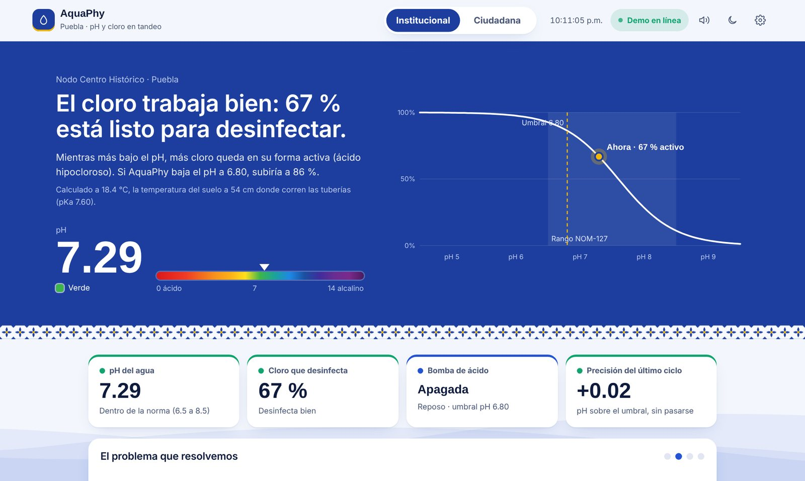
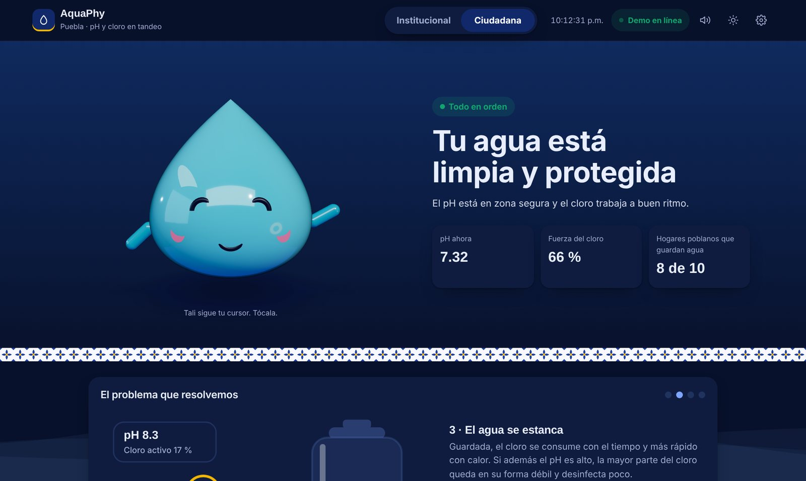

<p align="center"><a href="README.md">Español</a> | <b>English</b></p>

# AquaPhy · pH and chlorine in Puebla's rationed water

AquaPhy is an IoT node and a web dashboard for water stored in rooftop tanks and cisterns. The node
measures the pH, doses acid down to a threshold, and the dashboard shows how much of the chlorine is still
disinfecting. Built by team **Lagoonas** for the IoT water quality monitoring and control challenge at the MICROSIDE Hackathon.

**Live:** https://aqua-phy.vercel.app

<p align="center">
  <a href="https://aqua-phy.vercel.app"></a>
</p>

## The problem

In Puebla, water arrives by **rationing (tandeo)**: the mains go dry for hours or days, so 81.3 % of homes
store water in a rooftop tank or cistern (INEGI, 2020 Census). Stored chlorine decays over time, faster
in warm weather. And when pH rises, most of the chlorine shifts to its weak form (hypochlorite) and barely
disinfects.

AquaPhy measures pH and lowers it to the chosen threshold with short acid pulses. It then uses the Morris
equation to calculate how much of the chlorine is in its active form (hypochlorous acid, HOCl). At pH 7.0
there is roughly five times more active chlorine than at pH 8.3.

<p align="center">
  
</p>

## Components

| Part | Technology | What it does |
| --- | --- | --- |
| Node | ESP32-S3, pH probe, relay-driven pump, XN03A LED | Reads and filters pH, doses acid, locks out on temperature or emergency stop, and publishes everything to Blynk. |
| Cloud | Blynk.Cloud | Receives telemetry on 13 virtual pins and lets operators control the node remotely. |
| Dashboard | React 19, Vite, Recharts, Leaflet, Three.js | Two views, institutional and citizen, with live data or demo mode. |
| Open data | Open-Meteo, INEGI, NOM-127-SSA1-2021 | Weather and soil temperature in Puebla, housing data and the official limits. |

## Dashboard views

### Institutional view

For the water utility operator:

- Chlorine efficacy curve with the current pH and the threshold.
- Universal pH indicator (0 to 14), using the same color as the node's LED.
- PIN-protected control console: shutoff threshold, dosing and emergency stop.
- Live dosing cycle: raw reading, filtered reading and pump pulses.
- Probe to pH: ADC counts, voltage and conversion.
- Control accuracy: how close each cycle ended to the threshold.
- Node status: board temperature, acid dosed and solar panel battery.
- Challenge requirements checklist.
- Last 24 hours, including the supply cuts.
- pH versus temperature analysis.
- Contact time and CT value.
- Node map by municipality.
- Weather and soil temperature.
- Water stored at home (INEGI).
- Event log.
- Data sources.

<p align="center">
  
</p>

<p align="center">
  
</p>

<p align="center">
  
</p>

<p align="center">
  
</p>

### Citizen view

For people who store water at home:

- **Tali:** a 3D water drop that reacts to the water status and follows the cursor.
- **Mi agua (My water):** shows the state of the tank or cistern and whether the water is safe to drink. It checks three conditions: pH, chlorine and contact time.
- **Automatic or manual chlorination:** manual mode gives the chlorine dose for the tank size.
- **Rationing countdown:** time until water next arrives, plus a "Water just arrived at my house!" button.
- **Your tank now:** a digital twin of the tank.
- **Care for your water:** educational cards.

<p align="center">
  
</p>

<p align="center">
  
</p>

The dashboard has light and dark themes, sounds in sync with the node's buzzer, and pop-up alerts. It locks
operation based on temperature or pH:

- **Sounds:** one long tone at start, three short ones at the end, and droplets while the pump runs.
- **Pop-up alerts:** they warn when the board overheats or when an operation is locked.

The interface is in Spanish.

## Running it

Requirements: Node.js 20.19 or later and npm.

```bash
npm install
npm run dev          # http://localhost:5173
npm run build        # dist/ folder for Vercel or Netlify
npm run build:single # self-contained dist-single/index.html (Blynk HTML widget or sharing)
```

**Demo mode:** without a token, the dashboard starts with a simulator that mirrors the firmware's state machine.
To connect it to a real node:

1. Open the gear icon and go to "Conexión con Blynk".
2. Paste the server and the token.

The same dialog has "Simular calor" to trigger the temperature alert.

To set the token for a deployment, copy `.env.example` to `.env` and fill in `VITE_BLYNK_TOKEN`. The token
is visible in the browser, so use it for demos only. The console PIN is in `src/config.js`
(`PIN_OPERADOR`).

## Blynk: template datastreams

| Pin | Name | Type | Range | Use |
| --- | --- | --- | --- | --- |
| V0 | pH | Double | 0–14, 3 decimals | Filtered reading |
| V1 | Threshold | Double | 4.5–7, 2 decimals | Shutoff threshold |
| V2 | Dose | Integer | 0–2 | 1 start, 2 stop |
| V3 | State | Integer | 0–4 | Idle, Dosing, Settling, Threshold reached, Stop |
| V4 | Pump | Integer | 0–1 | Relay |
| V5 | Board temp. | Double | 0–100 °C | `temperatureRead()` |
| V6 | Color | String | | Universal indicator `#RRGGBB` |
| V7 | Stop | Integer | 0–1 | Emergency stop |
| V8 | Acid | Double | 0–200 mL | mL dosed |
| V9 | Voltage | Double | 0–15 V | Simulated (solar panel) |
| V10 | Pulse | Integer | 0–2000 ms | Last pulse |
| V11 | Raw pH | Double | 0–14, 3 decimals | Unfiltered, to show the noise |
| V12 | ADC | Integer | 0–1023 | 10-bit ADC counts |

Optional events (Templates → Events): `dosis_inicio`, `dosis_bloqueada`, `paro_emergencia`,
`temperatura_alta`. The pins must match `src/config.js` and the firmware.

## Firmware

The firmware is in `firmware/AquaPhy_ESP32/AquaPhy_ESP32.ino`. It targets the ESP32-S3 Dev Module board
and needs the Blynk library 1.3 or later.

1. Set `BLYNK_TEMPLATE_ID`, `BLYNK_AUTH_TOKEN`, your WiFi network and the relay pin.
2. Choose how the node runs:
   - With `MODO_SIMULACION = true`, it works without a probe or a pump.
   - For the real probe, set it to `false`.
3. Check the calibration. It already includes the challenge table: pH 7 = 1.648 V and pH 4 = 2.175 V, that
   is, pH = (892 − ADC) / 54.4. If your probe reads differently, measure it with the `C` serial command.
4. How the control works:
   - It starts with short pulses and applies only 75 % of each calculated pulse.
   - It waits 3 s and measures how much the pH dropped.
   - It corrects its estimate before the next pulse, so it approaches the threshold without overshooting.
5. How the filter works: it takes 15 samples, drops the 3 extremes on each side and applies an exponential average.
6. Starting is locked if the pH is already at the threshold, if the emergency stop is on, or if the board exceeds 55 °C.
7. **XN44 audio module:** the spots for its command are marked in `alertaInicio()` and `alertaFin()`.

Serial Monitor commands:

| Command | Action |
| --- | --- |
| `I 5.50` | Start with a threshold from 4.50 to 7.00 |
| `T` | Test (simulation only) |
| `L` | LED |
| `C` | Calibrate |
| `P` / `R` | Pause / resume |
| `D` | Stop |
| `N` | Reset |

## Data and assumptions

- **Housing (INEGI, 2020 Census, state of Puebla):**
  - 1,713,381 occupied private dwellings.
  - 72.8 % have a rooftop tank, 42.4 % a cistern, and 81.3 % at least one of the two.
  - In Cuautlancingo: 70.9 % and 49.7 %.
- **Chlorine efficacy:**
  - HOCl fraction = 1 / (1 + 10^(pH − pKa)), with a temperature-dependent pKa (Morris, 1966).
  - Soil temperature at 54 cm (Open-Meteo) is used as a reference for water temperature in buried pipes.
- **Standards:**
  - Safe pH from 6.5 to 8.5 and free residual chlorine from 0.2 to 1.5 mg/L (NOM-127-SSA1-2021).
  - WHO criterion: at least 0.5 mg/L after 30 min at pH below 8.
- **Simulated:**
  - Rationing schedules per neighborhood.
  - The five extra nodes on the map.
  - The solar panel voltage.
  - The estimated chlorine in "Mi agua". The prototype measures pH, not chlorine.

In the dashboard, every simulated value is labeled **Simulado**. The source for each figure is listed in
`src/data/fuentes.js` and in the "Fuentes y transparencia de datos" panel.

## Structure

```
AquaPhy/
├── firmware/AquaPhy_ESP32/AquaPhy_ESP32.ino   ESP32 node with Blynk
├── src/
│   ├── App.jsx, App.css, main.jsx             Top bar, views, themes and alerts
│   ├── config.js                              Virtual pins, limits and neighborhoods
│   ├── components/                            Panels for both views (Tecnica, Ciudadana, Gota3D...)
│   ├── hooks/                                 useAquaPhy (Blynk or simulator) and useClima (Open-Meteo)
│   ├── lib/                                   Chlorine chemistry, chlorination, simulator, sound and Blynk
│   └── data/                                  Sources and metropolitan-area municipalities
├── docs/capturas/                             Images used in this README
├── .env.example
└── vite.config.js
```

## Team Lagoonas

- Myrahis Sanluis
- María Valentina García
- Lourdes García
- Yaretzi López

Built for the MICROSIDE Hackathon, IoT water quality monitoring and control challenge.
