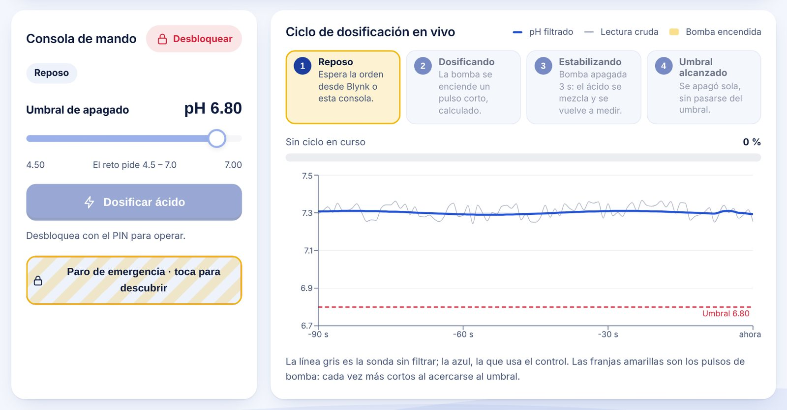
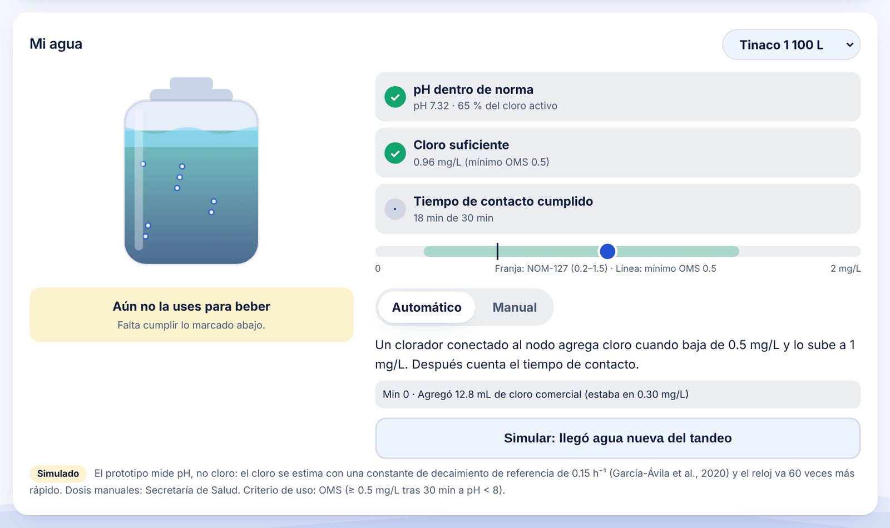

<p align="center"><b>Español</b> | <a href="README.en.md">English</a></p>

# AquaPhy · pH y cloro en el agua de tandeo de Puebla

Nodo IoT y tablero web que miden el pH del agua almacenada en tinacos y cisternas, dosifican ácido hasta
un umbral y muestran qué tanto del cloro sigue desinfectando. Proyecto del equipo **Lagoonas** para el reto de
monitoreo y control de calidad del agua IoT del Hackatón MICROSIDE.

**En línea:** https://aqua-phy.vercel.app

<p align="center">
  <a href="https://aqua-phy.vercel.app"></a>
</p>

## El problema

En Puebla el agua llega por **tandeo**: la red se queda sin servicio por horas o días, y por eso el 81.3 %
de las viviendas la guarda en tinaco o cisterna (INEGI, Censo 2020). Guardada, el cloro se consume con el
tiempo y más rápido con calor. Además, si el pH sube, la mayor parte del cloro pasa a su forma débil
(hipoclorito) y desinfecta poco.

AquaPhy mide el pH, lo baja con pulsos cortos de ácido hasta el umbral elegido y calcula, con la ecuación
de Morris, qué fracción del cloro queda en su forma activa (ácido hipocloroso, HOCl). A pH 7.0 hay cerca de
cinco veces más cloro activo que a pH 8.3.

<p align="center">
  
</p>

## Componentes

| Parte | Tecnología | Qué hace |
| --- | --- | --- |
| Nodo | ESP32-S3, sonda de pH, bomba con relé, LED XN03A | Lee y filtra el pH, dosifica ácido, bloquea por temperatura o paro de emergencia y publica todo en Blynk. |
| Nube | Blynk.Cloud | Recibe la telemetría en 13 pines virtuales y permite operar el nodo a distancia. |
| Tablero | React 19, Vite, Recharts, Leaflet, Three.js | Dos vistas, institucional y ciudadana, con datos en vivo o en modo demo. |
| Datos abiertos | Open-Meteo, INEGI, NOM-127-SSA1-2021 | Clima y temperatura del suelo en Puebla, vivienda y límites de la norma. |

## Vistas del tablero

### Vista institucional

Para el operador del sistema de agua:

- Curva de eficacia del cloro con el pH actual y el umbral.
- Indicador universal de pH (0 a 14) con el mismo color que el LED del nodo.
- Consola de mando protegida con PIN: umbral de apagado, dosificar y paro de emergencia.
- Ciclo de dosificación en vivo: lectura cruda, lectura filtrada y pulsos de bomba.
- De la sonda al pH: cuentas del ADC, voltaje y conversión.
- Precisión del control: qué tan cerca quedó cada ciclo del umbral.
- Estado del nodo: temperatura de la placa, ácido dosificado y batería del panel solar.
- Lista de lo que pide el reto, con su estado.
- Últimas 24 horas con los cortes de tandeo.
- Análisis de pH contra temperatura.
- Tiempo de contacto y valor CT.
- Mapa de nodos por municipio.
- Clima y temperatura del suelo.
- Agua guardada en casa (INEGI).
- Bitácora de eventos.
- Fuentes de datos.

<p align="center">
  
</p>

<p align="center">
  
</p>

<p align="center">
  
</p>

<p align="center">
  
</p>

### Vista ciudadana

Para quien guarda agua en casa:

- **Tali:** una gota en 3D que cambia según el estado del agua y sigue el cursor.
- **Mi agua:** muestra el estado del tinaco o la cisterna y si ya se puede beber. Revisa tres condiciones: pH, cloro y tiempo de contacto.
- **Cloración automática o manual:** el modo manual da la dosis de cloro para el tamaño del depósito.
- **Tandeo:** cuenta regresiva para la próxima llegada de agua y botón «¡Ya cayó el agua en mi casa!».
- **Tu tinaco ahora:** gemelo digital del tinaco.
- **Cuida tu agua:** tarjetas educativas.

<p align="center">
  
</p>

<p align="center">
  
</p>

El tablero tiene tema claro y oscuro, sonidos sincronizados con el buzzer del nodo y avisos emergentes.
Bloquea la operación por temperatura o por pH:

- **Sonidos:** un tono largo al iniciar, tres cortos al terminar y gotitas mientras la bomba está encendida.
- **Avisos emergentes:** avisan cuando la placa se calienta o cuando una operación queda bloqueada.

## Ejecutar

Requisitos: Node.js 20.19 o superior y npm.

```bash
npm install
npm run dev          # http://localhost:5173
npm run build        # carpeta dist/ para Vercel o Netlify
npm run build:single # dist-single/index.html autocontenido (widget HTML de Blynk o para compartir)
```

**Modo demo:** sin token, el tablero arranca con un simulador que replica la máquina de estados del firmware.
Para conectarlo a un nodo real:

1. Abre el engrane y entra a «Conexión con Blynk».
2. Pega el servidor y el token.

El mismo diálogo tiene «Simular calor» para mostrar la alerta de temperatura.

Para fijar el token en un despliegue, copia `.env.example` como `.env` y llena `VITE_BLYNK_TOKEN`. El
token queda visible en el navegador, así que úsalo solo para demostraciones. El PIN de la consola está en
`src/config.js` (`PIN_OPERADOR`).

## Blynk: Datastreams de la plantilla

| Pin | Nombre | Tipo | Rango | Uso |
| --- | --- | --- | --- | --- |
| V0 | pH | Double | 0–14, 3 decimales | Lectura filtrada |
| V1 | Umbral | Double | 4.5–7, 2 decimales | Umbral de apagado |
| V2 | Dosificar | Integer | 0–2 | 1 iniciar, 2 detener |
| V3 | Estado | Integer | 0–4 | Reposo, Dosificando, Estabilizando, Umbral alcanzado, Paro |
| V4 | Bomba | Integer | 0–1 | Relé |
| V5 | Temp. placa | Double | 0–100 °C | `temperatureRead()` |
| V6 | Color | String | | `#RRGGBB` del indicador universal |
| V7 | Paro | Integer | 0–1 | Paro de emergencia |
| V8 | Ácido | Double | 0–200 mL | mL dosificados |
| V9 | Voltaje | Double | 0–15 V | Simulado (panel solar) |
| V10 | Pulso | Integer | 0–2000 ms | Último pulso |
| V11 | pH crudo | Double | 0–14, 3 decimales | Sin filtrar, para ver el ruido |
| V12 | ADC | Integer | 0–1023 | Cuentas del ADC de 10 bits |

Eventos opcionales (Templates → Events): `dosis_inicio`, `dosis_bloqueada`, `paro_emergencia`,
`temperatura_alta`. Los pines deben coincidir con `src/config.js` y con el firmware.

## Firmware

El firmware está en `firmware/AquaPhy_ESP32/AquaPhy_ESP32.ino`, para la placa ESP32-S3 Dev Module con la
librería Blynk 1.3 o superior.

1. Escribe `BLYNK_TEMPLATE_ID`, `BLYNK_AUTH_TOKEN`, la red WiFi y el pin del relé.
2. Elige el modo de trabajo:
   - Con `MODO_SIMULACION = true` funciona sin sonda ni bomba.
   - Con la sonda real, ponlo en `false`.
3. Revisa la calibración. Ya trae la tabla del reto: pH 7 = 1.648 V y pH 4 = 2.175 V, es decir,
   pH = (892 − ADC) / 54.4. Si tu sonda da otros valores, mídela con el comando `C` del Monitor serie.
4. Así funciona el control:
   - Empieza con pulsos cortos y aplica solo el 75 % del pulso calculado.
   - Espera 3 s y mide cuánto bajó el pH.
   - Corrige su estimación antes del siguiente pulso, para acercarse al umbral sin pasarse.
5. Así funciona el filtro: toma 15 muestras, descarta los 3 extremos de cada lado y aplica un promedio exponencial.
6. El inicio se bloquea si el pH ya está en el umbral, si hay paro de emergencia o si la placa supera 55 °C.
7. **Módulo de audio XN44:** los puntos para su comando están marcados en `alertaInicio()` y `alertaFin()`.

Comandos del Monitor serie:

| Comando | Acción |
| --- | --- |
| `I 5.50` | Iniciar con un umbral de 4.50 a 7.00 |
| `T` | Prueba (solo en simulación) |
| `L` | LED |
| `C` | Calibrar |
| `P` / `R` | Pausa / reanudar |
| `D` | Detener |
| `N` | Reiniciar |

## Datos y supuestos

- **Vivienda (INEGI, Censo 2020, estado de Puebla):**
  - 1 713 381 viviendas particulares habitadas.
  - 72.8 % tiene tinaco, 42.4 % cisterna o aljibe, y 81.3 % alguno de los dos.
  - En Cuautlancingo: 70.9 % y 49.7 %.
- **Eficacia del cloro:**
  - Fracción de HOCl = 1 / (1 + 10^(pH − pKa)), con un pKa que depende de la temperatura (Morris, 1966).
  - Como referencia de la temperatura del agua en tuberías se usa la del suelo a 54 cm (Open-Meteo).
- **Normas:**
  - pH seguro de 6.5 a 8.5 y cloro residual libre de 0.2 a 1.5 mg/L (NOM-127-SSA1-2021).
  - Criterio de la OMS: al menos 0.5 mg/L tras 30 min a pH menor de 8.
- **Simulado:**
  - Los horarios de tandeo por colonia.
  - Los cinco nodos adicionales del mapa.
  - El voltaje del panel solar.
  - El cloro estimado en «Mi agua». El prototipo mide pH, no cloro.

En el tablero, todo dato simulado lleva la etiqueta **Simulado**. Las fuentes de cada cifra están en
`src/data/fuentes.js` y en el panel «Fuentes y transparencia de datos».

## Estructura

```
AquaPhy/
├── firmware/AquaPhy_ESP32/AquaPhy_ESP32.ino   Nodo ESP32 con Blynk
├── src/
│   ├── App.jsx, App.css, main.jsx             Barra, vistas, temas y alertas
│   ├── config.js                              Pines virtuales, límites y colonias
│   ├── components/                            Paneles de las dos vistas (Tecnica, Ciudadana, Gota3D...)
│   ├── hooks/                                 useAquaPhy (Blynk o simulador) y useClima (Open-Meteo)
│   ├── lib/                                   Química del cloro, cloración, simulador, sonido y Blynk
│   └── data/                                  Fuentes y municipios de la zona metropolitana
├── docs/capturas/                             Imágenes de este README
├── .env.example
└── vite.config.js
```

## Equipo Lagoonas

- Myrahis Sanluis
- María Valentina García
- Lourdes García
- Yaretzi López

Proyecto desarrollado para el Hackatón MICROSIDE, reto de monitoreo y control de calidad del agua IoT.
