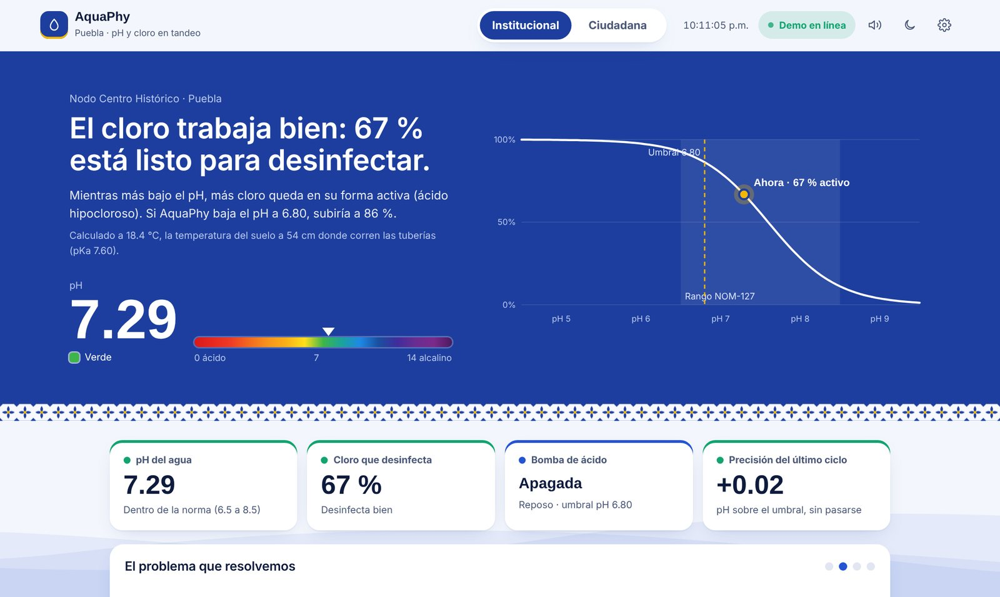
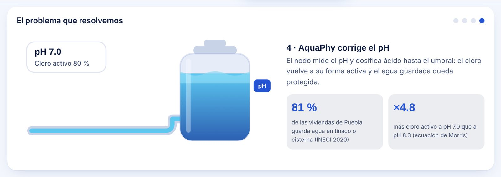
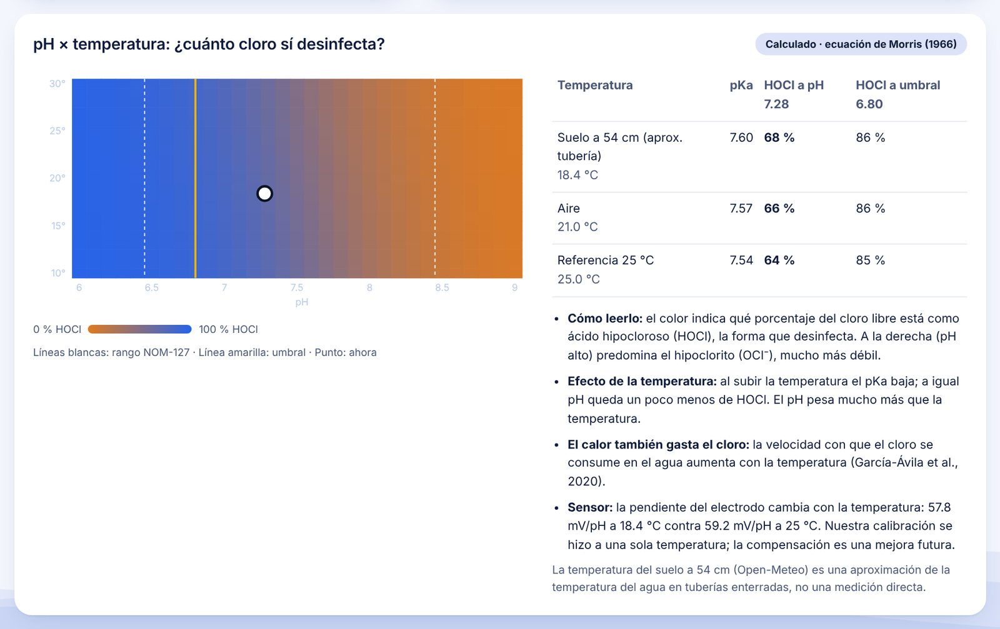
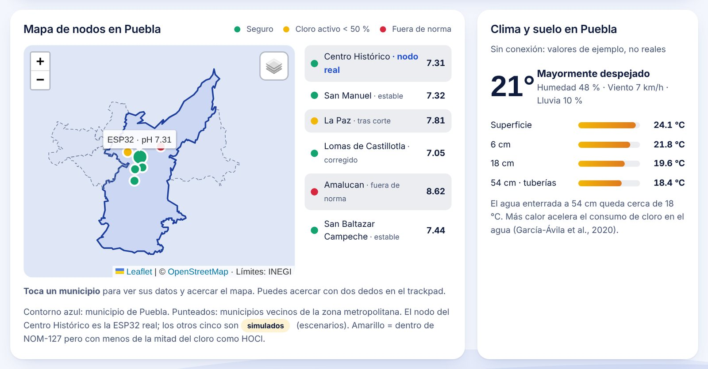
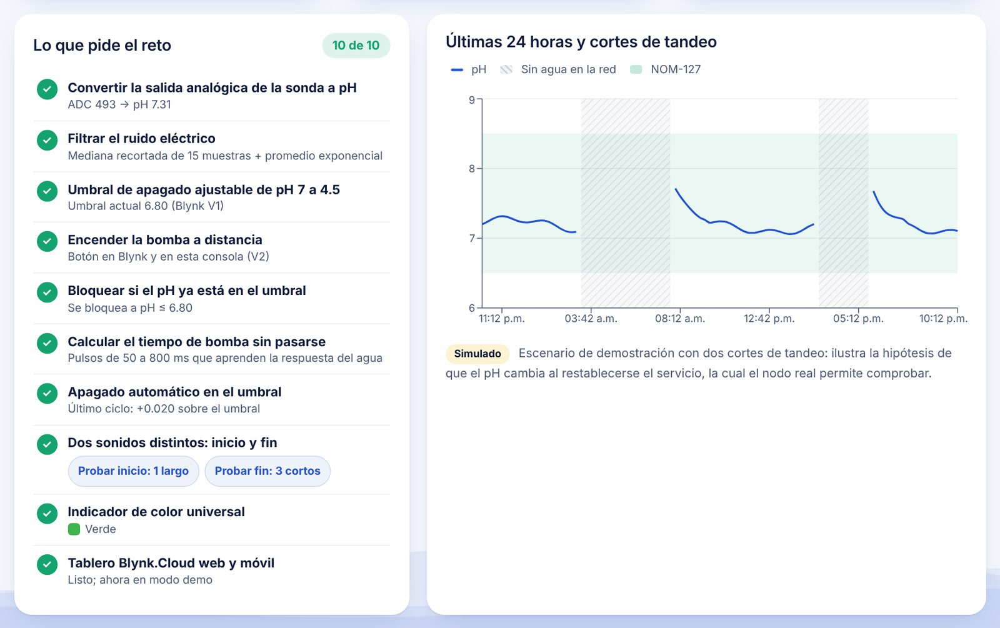
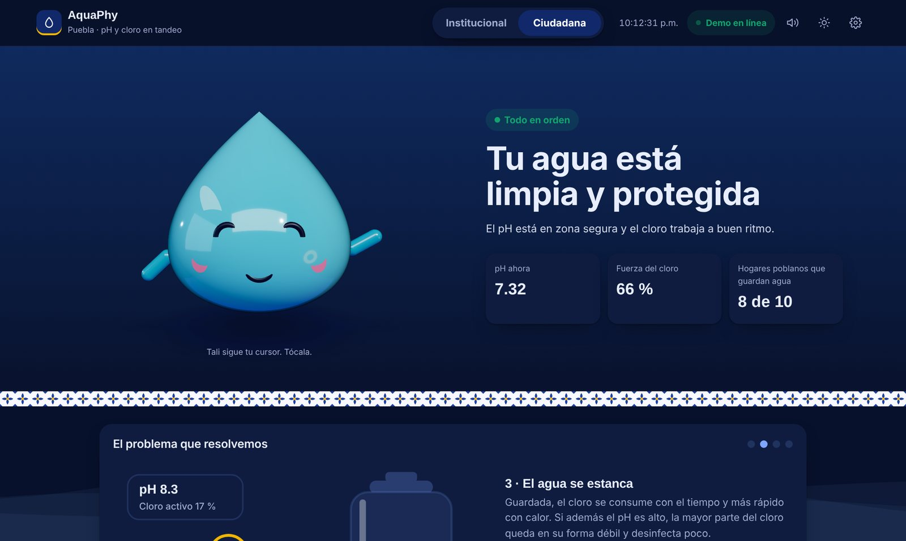
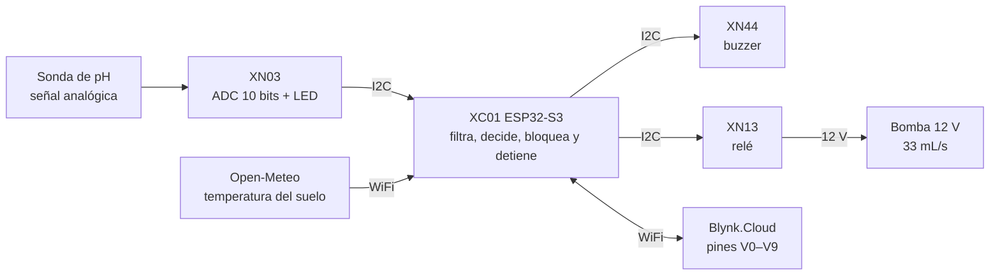
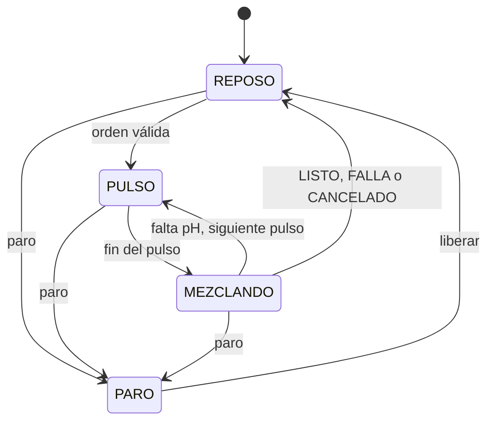

<p align="center"><b>Español</b> | <a href="README.en.md">English</a></p>

<p align="center">
  
</p>

# AquaPhy · pH y cloro en el agua de tandeo de Puebla

Nodo IoT y tablero web que miden el pH del agua almacenada en tinacos y cisternas, dosifican ácido hasta
un umbral y muestran qué tanto del cloro sigue desinfectando. Proyecto del equipo **Lagoonas** para el reto de
monitoreo y control de calidad del agua IoT del Hackatón MICROSIDE.

**En línea:** https://aqua-phy.vercel.app

<p align="center">
  <a href="https://aqua-phy.vercel.app"></a>
</p>

## Estado del proyecto

| Parte | Estado |
| --- | --- |
| Firmware final (`firmware/AquaPhy_ESP32`) | Funcional. Medición real calibrada: 5.42 contra 5.4 de un medidor de referencia |
| Dosificación automática | Probada en simulación; falta registrar una corrida real con la bomba |
| Panel de Blynk | Funcional; muestra los datos del nodo en tiempo real |
| Tablero web | Funciona en modo demo; **no está integrado** con el firmware final (usa otro mapa de pines) |

## Contenido

- [El problema](#el-problema)
- [Componentes](#componentes)
- [Vistas del tablero](#vistas-del-tablero)
- [Ejecutar](#ejecutar)
- [Firmware](#firmware)
- [Pines que usa el tablero](#pines-que-usa-el-tablero)
- [Avance del proyecto](#avance-del-proyecto)
- [Siguientes pasos](#siguientes-pasos)
- [Datos y supuestos](#datos-y-supuestos)
- [Referencias](#referencias)
- [Estructura](#estructura)
- [Equipo Lagoonas](#equipo-lagoonas)

## El problema

En Puebla el agua llega por **tandeo**: la red se queda sin servicio por horas o días, y por eso el 81.3 %
de las viviendas la guarda en tinaco o cisterna (INEGI, Censo 2020). Guardada, el cloro se consume con el
tiempo y más rápido con calor. Además, si el pH sube, la mayor parte del cloro pasa a su forma débil
(hipoclorito) y desinfecta poco.

AquaPhy mide el pH, lo baja con pulsos cortos de ácido hasta el umbral elegido y calcula, con la ecuación
de Morris, qué fracción del cloro queda en su forma activa (ácido hipocloroso, HOCl). A pH 7.0 hay cerca de
cinco veces más cloro activo que a pH 8.3.

<p align="center">
  
</p>

## Componentes

| Parte | Tecnología | Qué hace |
| --- | --- | --- |
| Nodo | ESP32-S3 (XC01), sonda de pH, relé XN13 con bomba, LED del XN03, buzzer XN44 | Lee y filtra el pH, dosifica ácido por pulsos, bloquea ante fallas o paro de emergencia y publica todo en Blynk. |
| Nube | Blynk.Cloud | Recibe la telemetría del nodo en 10 pines virtuales (V0–V9) y permite operarlo a distancia. |
| Tablero | React 19, Vite, Recharts, Leaflet, Three.js | Dos vistas, institucional y ciudadana, con datos en vivo o en modo demo. |
| Datos abiertos | Open-Meteo, INEGI, NOM-127-SSA1-2021 | Clima y temperatura del suelo en Puebla, vivienda y límites de la norma. |

## Vistas del tablero

### Vista institucional

Para el operador del sistema de agua:

- Curva de eficacia del cloro con el pH actual y el umbral.
- Indicador universal de pH (0 a 14) con el mismo color que el LED del nodo.
- Consola de mando protegida con PIN: umbral de apagado, dosificar y paro de emergencia.
- Ciclo de dosificación en vivo: lectura cruda, lectura filtrada y pulsos de bomba.
- De la sonda al pH: cuentas del ADC, voltaje y conversión.
- Precisión del control: qué tan cerca quedó cada ciclo del umbral.
- Estado del nodo: temperatura de la placa, ácido dosificado y batería del panel solar.
- Lista de lo que pide el reto, con su estado.
- Últimas 24 horas con los cortes de tandeo.
- Análisis de pH contra temperatura.
- Tiempo de contacto y valor CT.
- Mapa de nodos por municipio.
- Clima y temperatura del suelo.
- Agua guardada en casa (INEGI).
- Bitácora de eventos.
- Fuentes de datos.

<p align="center">
  
</p>

<p align="center">
  
</p>

<p align="center">
  
</p>

<p align="center">
  
</p>

### Vista ciudadana

Para quien guarda agua en casa:

- **Tali:** una gota en 3D que cambia según el estado del agua y sigue el cursor.
- **Mi agua:** muestra el estado del tinaco o la cisterna y si ya se puede beber. Revisa tres condiciones: pH, cloro y tiempo de contacto.
- **Cloración automática o manual:** el modo manual da la dosis de cloro para el tamaño del depósito.
- **Tandeo:** cuenta regresiva para la próxima llegada de agua y botón «¡Ya cayó el agua en mi casa!».
- **Tu tinaco ahora:** gemelo digital del tinaco.
- **Cuida tu agua:** tarjetas educativas.

<p align="center">
  
</p>

<p align="center">
  
</p>

El tablero tiene tema claro y oscuro, sonidos sincronizados con el buzzer del nodo y avisos emergentes.
Bloquea la operación por temperatura o por pH:

- **Sonidos:** un tono largo al iniciar, tres cortos al terminar y gotitas mientras la bomba está encendida. (Es el patrón del firmware anterior; el firmware final usa melodías, ver [Indicadores](#indicadores-led-y-sonidos).)
- **Avisos emergentes:** avisan cuando la placa se calienta o cuando una operación queda bloqueada.

## Ejecutar

Requisitos: Node.js 20.19 o superior y npm.

```bash
npm install
npm run dev          # http://localhost:5173
npm run build        # carpeta dist/ para Vercel o Netlify
npm run build:single # dist-single/index.html autocontenido (widget HTML de Blynk o para compartir)
```

**Modo demo:** sin token, el tablero arranca con un simulador que replica la máquina de estados del firmware.
Para conectarlo a un nodo real:

1. Abre el engrane y entra a «Conexión con Blynk».
2. Pega el servidor y el token.

El mismo diálogo tiene «Simular calor» para mostrar la alerta de temperatura.

Para fijar el token en un despliegue, copia `.env.example` como `.env` y llena `VITE_BLYNK_TOKEN`. El
token queda visible en el navegador, así que úsalo solo para demostraciones. El PIN de la consola está en
`src/config.js` (`PIN_OPERADOR`).

## Firmware

El firmware final está en `firmware/AquaPhy_ESP32/AquaPhy_ESP32.ino` (AquaMind SmartDose). Toda la lógica corre en el ESP32-S3: lectura y filtrado de la sonda, cálculo del pH con su margen de error, control de la bomba, alertas y paro de emergencia. Blynk muestra los datos y envía órdenes, y el nodo decide si es seguro obedecerlas.

El mismo programa tiene dos modos. En **modo REAL** lee la sonda y activa la bomba. En **modo DEMO** el pH sale de un simulador interno con 10 escenarios y el relé nunca se enciende.

### Usuarios y necesidades

Según las funciones del código, el prototipo atiende a dos usuarios:

- **Operador:** usa el panel de Blynk para ver el pH, fijar el umbral, iniciar la dosificación y activar el paro.
- **Técnico:** usa el Monitor Serie para diagnóstico y calibración, y lee los patrones del LED y los sonidos del buzzer al abrir la caja.

Necesidades que cubre el código:

- Saber cuánta solución agregar sin pasarse del umbral.
- No dosificar si el pH ya está en el umbral o si la lectura no es confiable.
- Conocer el margen de error de cada lectura.
- Recibir alertas con la causa probable de una falla.
- Detener la bomba de inmediato desde más de un lugar.

### Hardware del nodo

| Componente | Función | Conexión y datos técnicos |
| --- | --- | --- |
| Electrodo de pH + tarjeta PH_Sensor | Mide la acidez y entrega un voltaje analógico | V+ a 3V3, G a GND, Po a IN1 del XN03, To a IN2 (opcional) |
| XN03 | Convierte el voltaje a digital y muestra el color del pH | I2C 0x03; ADC de 10 bits (0–1023); registro 0x21 = IN1, 0x22 = IN2; LED RGB en registro 0x01 |
| XN13 | Relé que enciende la bomba de 12 V | I2C 0x0D; formato de 1 byte (0x01 enciende, 0x00 apaga), comprobado en prueba |
| XC01 R5-I | Microcontrolador ESP32-S3 con WiFi | I2C en SDA 12 y SCL 13; botón BOOT (GPIO 0) como paro de emergencia |
| XN44 | Buzzer para alertas sonoras | I2C 0x2C; frecuencia y duración de 2 bytes cada una |
| XN14 | Fuente de alimentación | Entrada de 12 V; salidas de 5 V y 3.3 V |
| Bomba de diafragma 12 V | Agrega la solución reguladora | 33 mL/s; pulso mínimo de 50 ms (1.65 mL) y máximo de 1500 ms (49.5 mL) |
| Contenedores | Solución de pH 4 y agua de prueba | 100 mL de solución y 200 mL de agua |

**Conexión de la bomba al relé:** 12 V (+) a COM, NO al (+) de la bomba, (−) de la bomba a GND, NC sin conectar.



Todas las decisiones se toman en el ESP32: Blynk muestra los datos y envía órdenes, y el equipo decide si es seguro obedecerlas. La fuente XN14 alimenta a todos los módulos.

### Herramientas y tecnologías

| Tipo | Herramienta | Uso |
| --- | --- | --- |
| Lenguaje | C++ (Arduino) | Firmware completo en un solo archivo |
| Entorno | Arduino IDE con placa «ESP32S3 Dev Module» y «USB CDC On Boot: Enabled» | Compilación, carga y Monitor Serie a 115200 baudios |
| Librería externa | Blynk (Volodymyr Shymanskyy) | Conexión con Blynk.Cloud |
| Librerías del ESP32 | Wire, WiFi, HTTPClient, Preferences, time | I2C, red, consulta HTTP, memoria no volátil y hora por NTP |
| Plataforma IoT | Blynk.Cloud (plantilla AquaPhy, dispositivo Nodo1) | Panel web y móvil con 10 variables |
| Servicio externo | API de Open-Meteo | Temperatura del suelo a 54 cm y del aire en Puebla (19.04, −98.21) |
| Hardware | Kit XIDE de Microside | Módulos de la sección [Hardware](#hardware-del-nodo) |
| Tablero | React 19, Vite, Recharts, Leaflet, Three.js | Vistas institucional y ciudadana (sección [Vistas del tablero](#vistas-del-tablero)) |

### Cargar el firmware

1. Instala el soporte de placas ESP32 en Arduino IDE y la librería **Blynk** (Volodymyr Shymanskyy).
2. Placa: **ESP32S3 Dev Module**, con **USB CDC On Boot: Enabled**.
3. Abre `firmware/AquaPhy_ESP32/AquaPhy_ESP32.ino` y reemplaza:
   - `TU_AUTH_TOKEN` por el Auth Token del dispositivo en Blynk.
   - `TU_WIFI_2_4GHZ` y `TU_CONTRASENA` por tu red. El ESP32 solo se conecta a redes de 2.4 GHz.
4. Carga el programa y abre el Monitor Serie a 115200 baudios con «New Line». Si no aparece nada, presiona RST.

> [!WARNING]
> No subas tu contraseña de WiFi ni tu token al repositorio.

El equipo arranca en **modo DEMO** (pH simulado, relé siempre apagado). Para usar la sonda y la bomba, cambia a **modo REAL** con el comando `m` o con V6 = 0 en Blynk.

### Calibración

Pon el electrodo y un medidor de referencia en el mismo vaso, espera a que la lectura varíe solo ±0.02 durante un minuto y escribe `k` seguido del valor del medidor con punto decimal (por ejemplo `k5.40`). Para dos puntos usa `p4.00` y luego `p7.00` (deben diferir más de 1 pH). `f` restaura la calibración de fábrica. La calibración queda guardada en memoria no volátil.

> [!NOTE]
> El comando `k` no valida el valor: revisa el número antes de enviarlo. No calibres en agua de enjuague, porque el electrodo tarda en estabilizarse en agua con pocas sales.

### Funcionamiento del firmware

#### Organización del código

El archivo `AquaPhy_ESP32.ino` tiene 18 secciones numeradas, cada una con una sola responsabilidad.

| Secciones | Contenido |
| --- | --- |
| 1–2 | Direcciones I2C, registros, calibración de fábrica y constantes del reto |
| 3–5 | Escala oficial de colores, escenarios de simulación y melodías |
| 6–7 | Bits de alerta y variables de estado |
| 8–10 | Funciones de los módulos I2C, sonido no bloqueante, color y patrones del LED |
| 11–12 | Simulador del modo DEMO y cadena de medición |
| 13 | Temperatura de Open-Meteo y diagnóstico del equipo |
| 14 | Dosificación, paro y botón BOOT |
| 15 | Revisión de alertas |
| 16 | Envío de datos y órdenes de Blynk |
| 17 | Comandos del Monitor Serie |
| 18 | Tareas periódicas, setup y loop |

#### Inicialización

Al encender, el equipo apaga el relé, carga la calibración y los contadores de la bomba desde la memoria no volátil, elige el escenario 0 y se conecta al WiFi (hasta 10 s). Luego pide la hora por NTP (UTC−6), se conecta a Blynk y programa las tareas periódicas:

| Cada | Tarea |
| --- | --- |
| 50 ms | Seguridad de la bomba: la apaga si un pulso pasa de 1.8 s |
| 100 ms | Lectura de la sonda (o del simulador) y filtrado |
| 1 s | Pendiente del pH, margen de error, alertas y revisión de la mezcla |
| 2 s | Reafirma el relé apagado cuando no debe estar encendido; envía pH, color y estado a Blynk |
| 5 s | Diagnóstico: temperatura del chip, señal WiFi, solución restante y ciclos de la bomba |
| 10 s | Telemetría completa a Blynk |
| 15 s | Revisa si toca consultar Open-Meteo (cada 30 min, solo en reposo) |

El ciclo principal no usa `delay`: atiende el sonido, el LED, el botón BOOT y el Monitor Serie en cada vuelta.

#### Medición del pH

1. Lee el ADC del XN03 (entrada IN1) cada 100 ms y guarda las últimas 30 lecturas.
2. Quita picos con la mediana de las últimas 9 lecturas.
3. Suaviza con un filtro exponencial (α = 0.2).
4. Convierte a pH con la recta de la tabla del reto: pH = (892 − ADC) / 54.43.
5. Compensa la temperatura con la ecuación de Nernst: pH = 7 + (pH − 7) × 298.15 / (T + 273.15), con T en °C.

La temperatura del agua se estima con la del suelo a 54 cm de Open-Meteo. Si no hay respuesta, usa 25 °C.

**Margen de error.** Cada segundo combina cuatro componentes: ruido tras el filtro (2/3 de la desviación estándar), resolución del ADC, calibración (0.10 de fábrica, 0.05 con un punto, 0.03 con dos) y temperatura (±3 °C si viene de Open-Meteo, ±10 °C si es el valor por defecto). El resultado es la raíz de la suma de sus cuadrados. Con él calcula un índice de calidad de 0 a 100.

#### Dosificación

La dosificación es una máquina de estados con cuatro estados: REPOSO, PULSO, MEZCLANDO y PARO.



**Antes de iniciar**, el equipo bloquea la orden (estado BLOQUEADO, sonido «no-no») si no hay lectura válida, si hay una alerta crítica o si el pH ya es menor o igual al umbral + 0.05.

**Algoritmo por pulsos que aprende:**

1. Primer pulso mínimo de 1.65 mL para medir cómo responde el agua.
2. Espera la mezcla: mínimo 6 s; termina cuando el pH cambia menos de 0.01 pH/s o a los 30 s.
3. Calcula la pendiente: cuánto bajó el pH por cada mL. La actualiza de forma conservadora con cada pulso.
4. Siguiente pulso = 40 % × (pH actual − umbral) / pendiente, sin pasar del doble del pulso anterior ni de la solución disponible.
5. Repite hasta una condición de fin.

| Condición de fin | Resultado |
| --- | --- |
| pH − umbral ≤ 0.05 | LISTO: umbral alcanzado (melodía de fin) |
| Un pulso mínimo dejaría el pH más lejos del umbral que ahora | LISTO: lo más cerca posible |
| 3 pulsos seguidos con cambio menor a 0.02 pH y 10 mL o más | FALLA: la bomba no cambia el pH |
| Quedan menos de 1.65 mL de solución (se reservan 5 mL) | FALLA: sin solución suficiente |
| Sonda desconectada o congelada durante la dosificación | FALLA: falla de sonda |
| Bomba encendida más de 1.8 s | FALLA: seguridad de la bomba |
| Orden de cancelar (V2 = 0, comandos `x` o `q`, cambio de modo) | CANCELADO |

La razón de este algoritmo es que el agua de la llave tiene bicarbonato, que amortigua el ácido: el pH baja lento y luego cae de golpe. Un tiempo fijo de bomba se pasaría del umbral. El sistema solo puede bajar el pH.

#### Paro de emergencia

El paro apaga el relé y deja el equipo en estado PARO. Se activa con V9 = 1 en Blynk, con el comando `e` o con un toque al botón BOOT. Se libera con V9 = 0, con el comando `r` o manteniendo BOOT 3 s. Liberar el paro también borra la alerta `SIN_EFECTO`.

#### Alertas

| Código | Prioridad | Se activa cuando |
| --- | --- | --- |
| `PARO` | Crítica | El paro de emergencia está activo |
| `SONDA_DESC` | Crítica | El ADC marca menos de 5 o más de 1018 |
| `SONDA_CONG` | Crítica | La lectura no varía nada durante 15 s |
| `SIN_EFECTO` | Crítica | 3 pulsos (10 mL o más) sin cambio de pH |
| `SENAL_RUIDOSA` | Aviso | El ruido supera 0.15 pH |
| `CAMBIO_SUBITO` | Aviso | El pH cambia más de 0.05 pH/s en reposo |
| `SOLUCION_BAJA` | Aviso | Quedan menos de 20 mL de solución |
| `CHIP_CALIENTE` | Aviso | El chip pasa de 70 °C |
| `WIFI_DEBIL` | Aviso | La señal es menor a −80 dBm |
| `MANTENIMIENTO` | Aviso | La bomba pasa de 5000 ciclos |
| `SIN_NUBE` | Informativa | No hay conexión con Blynk |
| `FUERA_NORMA` | Informativa | El pH está fuera de 6.5–8.5 (NOM-127-SSA1-2021) |

Las alertas críticas bloquean la dosificación, suenan con 10 pulsos rápidos y se repiten cada 20 s. Los avisos suenan con 3 pulsos. Las informativas no suenan.

#### Indicadores: LED y sonidos

| Situación | LED del XN03 | Buzzer XN44 |
| --- | --- | --- |
| Normal | Color fijo de la escala oficial, interpolado entre valores enteros | — |
| Inicio de dosificación | Respira (ciclo de 2 s) mientras dosifica o mezcla | Do-Mi-Sol ascendente (1047, 1319, 1568 Hz) |
| Cada pulso | — | Clic de 25 ms a 2500 Hz |
| Fin de dosificación | Vuelve a color fijo | Sol-Mi-Do descendente, la última nota larga |
| Bloqueo | — | Dos notas graves de 440 Hz |
| Aviso | Se apaga 150 ms cada 2 s | 3 pulsos de 1319 Hz |
| Alerta crítica | Destello blanco rápido | 10 pulsos de 1760 Hz en grupos 3+2, 3+2 |
| Paro | Blanco que parpadea cada 0.5 s | Escalera descendente |
| Sin lectura | Blanco tenue | — |
| Conexión con Blynk | — | Chirrido corto |

El blanco no existe en la escala de pH, por eso se reserva para fallas.

#### Modo DEMO

El simulador modela el bicarbonato del agua con Henderson-Hasselbalch (pKa₁ = 6.35) y un retraso de la sonda de 4 s. Cada pulso agrega el ácido correspondiente al volumen dosificado. Los valores son ilustrativos.

| # | Escenario | Qué simula |
| --- | --- | --- |
| 0 | Normal | Agua a pH 7.30 |
| 1 | Agua dura / sarro | pH 8.00 que sube a 8.30; más bicarbonato |
| 2 | Descarga ácida | El pH baja hacia 5.20 |
| 3 | Contaminante alcalino | El pH sube hacia 9.60 |
| 4 | Exceso de hipoclorito | Agua a pH 8.80 |
| 5 | Sonda desconectada | ADC fijo en 1023 |
| 6 | Electrodo dañado / burbuja | Ruido de 0.25 pH y picos de 1.5 |
| 7 | Señal congelada | ADC idéntico siempre |
| 8 | Tanque vacío / manguera tapada | La solución no entra |
| 9 | Fuga / dilución | El pH regresa hacia 7.30 |

### Blynk en el firmware

Datastreams de la plantilla **AquaPhy** (dispositivo **Nodo1**) que usa el firmware final:

| Pin | Nombre | Tipo | Uso |
| --- | --- | --- | --- |
| V0 | ph | Double (0–14) | pH filtrado y compensado; el equipo también cambia el color del widget |
| V1 | umbral | Double (4.5–7) | Umbral de apagado (por defecto 6.00) |
| V2 | dosificar | Integer (0–1) | 1 = iniciar, 0 = cancelar |
| V3 | estado | String | `CODIGO\|mensaje` |
| V4 | bomba | Integer (0–1) | Bomba encendida |
| V5 | incertidumbre | Double | ± del pH |
| V6 | modo | Integer (0–1), por defecto 1 | 1 = DEMO, 0 = REAL |
| V7 | escenario | Integer (0–9) | Escenario del modo DEMO |
| V8 | telemetria | String | JSON cada 10 s (tabla siguiente) |
| V9 | paro | Integer (0–1) | 1 = paro, 0 = liberar |

Para cuidar el límite de mensajes del plan gratuito, el equipo solo envía un valor cuando cambia. Al conectarse recupera el umbral, el modo y el escenario guardados en Blynk.

| Campo de V8 | Significado |
| --- | --- |
| `t`, `te` | Temperatura del agua (°C) y si viene de Open-Meteo (1) o es la de por defecto (0) |
| `ta`, `tc` | Temperatura del aire y del chip (°C) |
| `vo` | Voltaje de la entrada To (V) |
| `w` | Señal WiFi (dBm) |
| `h` | Cloro activo como HOCl (%), con el pKa de Morris dependiente de la temperatura |
| `d` | Velocidad de cambio del pH (pH/min) |
| `q` | Índice de calidad de la lectura (0–100) |
| `v`, `r` | mL dosificados en la corrida y mL de solución restantes |
| `c`, `s` | Ciclos y segundos acumulados de la bomba |
| `a` | Alertas activas (bits) |
| `e`, `m` | Escenario y modo (1 = DEMO) |

### Comandos del Monitor Serie

| Comando | Acción |
| --- | --- |
| `d` | Diagnóstico completo: lectura, calibración, temperaturas, WiFi, bomba, módulos I2C y alertas |
| `m` | Cambia entre DEMO y REAL |
| `s0`–`s9` | Elige escenario (solo en DEMO) |
| `i5.5` | Fija el umbral y dosifica |
| `q` | Pausa o reanuda todo; apaga la bomba |
| `x` | Cancela la dosificación |
| `e` / `r` | Activa o libera el paro |
| `k5.40` | Calibra a un punto con el valor del medidor de referencia |
| `p4.00` y `p7.00` | Calibra a dos puntos |
| `f` | Restaura la calibración de fábrica |
| `z` | Reinicia los contadores de la bomba y la solución |
| `l` / `b` | Prueba los 15 colores o las melodías |
| `c` | Colores suaves o por entero |

## Pines que usa el tablero

El tablero se diseñó con el mapa de pines de una versión anterior del firmware (definido en `src/config.js`). **No coincide con el firmware final** (sección [Blynk en el firmware](#blynk-en-el-firmware)); para integrarlo hay que cambiar `src/config.js` a los pines V0–V9.

| Pin | Nombre | Tipo | Rango | Uso |
| --- | --- | --- | --- | --- |
| V0 | pH | Double | 0–14, 3 decimales | Lectura filtrada |
| V1 | Umbral | Double | 4.5–7, 2 decimales | Umbral de apagado |
| V2 | Dosificar | Integer | 0–2 | 1 iniciar, 2 detener |
| V3 | Estado | Integer | 0–4 | Reposo, Dosificando, Estabilizando, Umbral alcanzado, Paro |
| V4 | Bomba | Integer | 0–1 | Relé |
| V5 | Temp. placa | Double | 0–100 °C | `temperatureRead()` |
| V6 | Color | String | | `#RRGGBB` del indicador universal |
| V7 | Paro | Integer | 0–1 | Paro de emergencia |
| V8 | Ácido | Double | 0–200 mL | mL dosificados |
| V9 | Voltaje | Double | 0–15 V | Simulado (panel solar) |
| V10 | Pulso | Integer | 0–2000 ms | Último pulso |
| V11 | pH crudo | Double | 0–14, 3 decimales | Sin filtrar, para ver el ruido |
| V12 | ADC | Integer | 0–1023 | Cuentas del ADC de 10 bits |

Eventos opcionales (Templates → Events): `dosis_inicio`, `dosis_bloqueada`, `paro_emergencia`,
`temperatura_alta`. Los pines deben coincidir con `src/config.js` y con el firmware.

## Avance del proyecto

### Funcionalidades implementadas en el firmware

- Medición del pH con filtrado, compensación de temperatura, margen de error e índice de calidad.
- Calibración a uno y dos puntos guardada en memoria.
- Dosificación por pulsos con aprendizaje de la pendiente y bloqueo junto al umbral.
- Paro de emergencia desde Blynk, Monitor Serie y botón BOOT.
- 12 alertas con causa probable, sonido por prioridad y patrones del LED.
- Indicador de color con la escala oficial del reto.
- Modo DEMO con 10 escenarios.
- Panel de Blynk con 10 variables y telemetría.
- Diagnóstico y calibración desde el Monitor Serie.
- Contadores de la bomba guardados en memoria para mantenimiento.

### Pruebas con el equipo real (19 de noviembre de 2026)

| Prueba | Resultado |
| --- | --- |
| Sonda sin calibrar contra medidor de referencia | 5.18 contra 5.4 |
| Sonda calibrada a un punto (`k5.40`) | 5.42 contra 5.4 |
| Relé XN13 con formato de 1 byte | La bomba ya no arranca sola |
| Panel de Blynk | Nodo1 en línea, modo REAL, pH 5.34 ± 0.053 |
| Dosificación real hasta un umbral | *Pendiente: no hay datos registrados* |

### Validación del algoritmo en simulación

Antes de cargarlo al equipo, el algoritmo de dosificación se probó en una simulación en Python con el mismo modelo de bicarbonato (escenario Normal).

| Umbral pedido | pH final | Diferencia |
| --- | --- | --- |
| 7.0 | 7.03 | +0.03 |
| 6.5 | 6.51 | +0.01 |
| 6.0 | 6.04 | +0.04 |
| 5.5 | 5.51 | +0.01 |
| 5.0 | 5.03 | +0.03 |
| 4.5 | 4.04 | −0.46 |

Cinco de seis umbrales quedan dentro de ±0.05. En 4.5 el pH se pasa porque cerca de pH 4.5–5 el agua ya no amortigua y un solo pulso mínimo lo baja unos 0.4–0.6. El sistema solo puede bajar el pH: no tiene solución básica para corregir.

### Problemas encontrados y cómo se resolvieron

| Problema | Causa | Solución |
| --- | --- | --- |
| La bomba se encendía sola con la orden de apagar | El XN13 de este kit interpretaba el formato de 2 bytes como «encender» | Formato de 1 byte y reafirmación de «apagado» cada 2 s |
| El pH no coincidía con el medidor de referencia | El equipo estaba en modo DEMO | Cambiar a modo REAL (comando `m` o switch Modo) |
| La calibración dejó el pH en 0.20 | Valor de referencia mal tecleado | Comando `f` y recalibrar con `k5.4` |
| El pH subía sin parar en agua de enjuague | El electrodo tarda en estabilizarse en agua con pocas sales | Esperar a que varíe solo ±0.02 durante 1 min; no calibrar en agua de enjuague |
| El ESP32 no se conectaba a la red wifi_Alumnos | No confirmada; el ESP32 solo usa redes de 2.4 GHz | Punto de acceso del celular en 2.4 GHz |
| El Monitor Serie no mostraba nada | USB CDC On Boot desactivado | Activarlo y presionar RST |

### Limitaciones conocidas

- **Página web sin integrar.** Se diseñó con un mapa de pines anterior y no se conectó al firmware final; durante el hackatón los datos solo se vieron en Blynk.
- **Dosificación real sin registro.** El algoritmo funciona en simulación, pero no hay datos de una corrida completa con la bomba.
- **Calibración a un punto sin validación.** El comando `k` acepta cualquier valor; un error de tecleo deja la recta mal (como el caso de pH 0.20).
- **Texto de la alerta `SONDA_DESC`.** Dice «tarjeta sin 5 V», pero la tarjeta de pH se conecta a 3.3 V.
- **Solo baja el pH.** Si se pasa del umbral no puede corregir.
- **Temperatura estimada.** No hay sensor en el agua; se usa la del suelo de Open-Meteo.
- **Comandos `l` y `b` bloquean.** Usan `delay` mientras prueban colores y melodías.

## Siguientes pasos

- Registrar una dosificación real completa (pH inicial y final, pulsos, mL y tiempo) con video.
- Conectar la página web a los pines V0–V9 del firmware final y probarla con el equipo.
- Validar el valor del comando `k` antes de guardarlo.
- Corregir el texto de la alerta `SONDA_DESC` a 3.3 V.
- Agregar fotos del montaje y capturas del panel de Blynk como evidencia.

## Datos y supuestos

- **Vivienda (INEGI, Censo 2020, estado de Puebla):**
  - 1 713 381 viviendas particulares habitadas.
  - 72.8 % tiene tinaco, 42.4 % cisterna o aljibe, y 81.3 % alguno de los dos.
  - En Cuautlancingo: 70.9 % y 49.7 %.
- **Eficacia del cloro:**
  - Fracción de HOCl = 1 / (1 + 10^(pH − pKa)), con un pKa que depende de la temperatura (Morris, 1966).
  - Como referencia de la temperatura del agua en tuberías se usa la del suelo a 54 cm (Open-Meteo).
- **Normas:**
  - pH seguro de 6.5 a 8.5 y cloro residual libre de 0.2 a 1.5 mg/L (NOM-127-SSA1-2021).
  - Criterio de la OMS: al menos 0.5 mg/L tras 30 min a pH menor de 8.
- **Simulado:**
  - Los horarios de tandeo por colonia.
  - Los cinco nodos adicionales del mapa.
  - El voltaje del panel solar.
  - El cloro estimado en «Mi agua». El prototipo mide pH, no cloro.

En el tablero, todo dato simulado lleva la etiqueta **Simulado**. Las fuentes de cada cifra están en
`src/data/fuentes.js` y en el panel «Fuentes y transparencia de datos».

## Referencias

- Microside, reto «Monitoreo y control de calidad de agua IoT» y curso introductorio del kit XIDE: [docs.microside.com](https://docs.microside.com/workshops/hackathon/reto-monitoreo-y-control-de-calidad-de-agua-iot)
- Blynk, documentación y límites del plan: [docs.blynk.io](https://docs.blynk.io)
- Open-Meteo, API de pronóstico (`soil_temperature_54cm`): [open-meteo.com/en/docs](https://open-meteo.com/en/docs)
- NOM-127-SSA1-2021, agua para uso y consumo humano (rango de pH 6.5–8.5).
- Morris, J. C. (1966): pKa del ácido hipocloroso en función de la temperatura, usado para calcular el % de HOCl.
- IEC 60601-1-8, patrones de prioridad de alarmas sonoras.

## Estructura

```
AquaPhy/
├── firmware/AquaPhy_ESP32/AquaPhy_ESP32.ino   Nodo ESP32 con Blynk (firmware final)
├── src/
│   ├── App.jsx, App.css, main.jsx             Barra, vistas, temas y alertas
│   ├── config.js                              Pines virtuales, límites y colonias
│   ├── components/                            Paneles de las dos vistas (Tecnica, Ciudadana, Gota3D...)
│   ├── hooks/                                 useAquaPhy (Blynk o simulador) y useClima (Open-Meteo)
│   ├── lib/                                   Química del cloro, cloración, simulador, sonido y Blynk
│   └── data/                                  Fuentes y municipios de la zona metropolitana
├── docs/tali.svg                              Animación de Tali para este README
├── docs/capturas/                             Imágenes de este README
├── Presentación/                              Presentación del hackatón (PDF)
├── .env.example
└── vite.config.js
```

## Equipo Lagoonas

| Integrante | Rol |
| --- | --- |
| [Myrahis Yurizahan Sanluis Cerezo](https://github.com/MyrahisYSanluis) | Página web e investigación del problema |
| [María Valentina García Hernandez](https://github.com/Valoo-1201) | Página web |
| [Yaretzi Abigail López Hernández](https://github.com/yarealh7-maker) | Hardware y funcionamiento con Blynk |
| [Lourdes María García Garfias](https://github.com/Luluugr?tab=repositories) | Hardware y funcionamiento con Blynk |

Proyecto desarrollado para el Hackatón MICROSIDE, reto de monitoreo y control de calidad del agua IoT.
